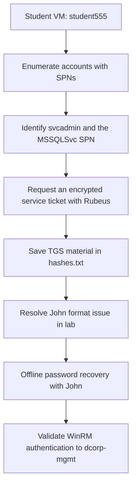

> [!INFO] 
> 1. We need to identify an Active Directory account associated with a SQL Server SPN, request a Kerberos service ticket, examine its offline-crackable representation, recover the password in the lab, and validate the account's access to `dcorp-mgmt`.

## Attack flow



  

> [!NOTE]
> In questo esercizio partiamo dal nostro utente `student555`, che non conosce la password di `svcadmin`. 
> Cerchiamo un account associato a uno SPN, richiediamo al Domain Controller un ticket per quel servizio e analizziamo offline la parte cifrata del ticket. 
> Se la password è abbastanza debole e presente nella wordlist, possiamo recuperarla. Solo dopo verifichiamo se il servizio WinRM di `dcorp-mgmt` accetta le credenziali ottenute.

  
---


## 1. Prepare our PowerShell environment

First, we need PowerView to inspect the permissions stored in Active Directory. We begin from our Student VM and load the lab environment:

```powershell
. C:\AD\Tools\InviShell\RunWithRegistryNonAdmin.bat

. C:\AD\Tools\PowerView.ps1
```


---
## 2. Identify Kerberoastable accounts

> [!warning] HINTS
> When reviewing SPNs, we should note the associated account, service type, and privilege level. 
> 
> An SPN makes the account a potential Kerberoasting subject; it does not by itself prove the service is reachable or the password is weak.


Now we need to discover domain user accounts that have at least one **Service Principal Name (SPN)** configured.
  
```powershell
Get-DomainUser -SPN
```
- If we want to focus on the relevant fields, we can filter the output with `| Select-Object DisplayName, ServicePrincipalName`

![[Pasted image 20261126145921.png]]


From the output, we identify the following SPN:

```text
MSSQLSvc/dcorp-mgmt.dollarcorp.moneycorp.local:1433
```

This SPN is associated with the domain account `svcadmin`. 
In this lab, we already know from earlier enumeration that `svcadmin` has high domain privileges, which makes it particularly interesting.
  
**What does the SPN tell us?**
- The SPN is registered on the `svcadmin` account, which supplies the identity/key material associated with that service principal.


> [!NOTE] 🇮🇹 Spiegazione in italiano
> Cerchiamo gli utenti con l'attributo `servicePrincipalName` valorizzato. 
> Nel risultato troviamo `svcadmin`, collegato al servizio SQL Server identificato dallo SPN `MSSQLSvc/...:1433`.
> **Il fatto che l'account abbia uno SPN ci permette di considerarlo per Kerberoasting, ma non dimostra da solo che il servizio SQL sia attivo o che l'account sia Domain Admin.**


---

> [!NOTE] 🇮🇹 Spiegazione in italiano
> Un utente di dominio autenticato può normalmente chiedere al KDC un ticket per un servizio registrato, anche se non ha ancora i permessi applicativi per usare quel servizio. 
> 
> Il KDC produce un ticket contenente una parte cifrata con la chiave collegata all'account del servizio.
>  È questa parte cifrata che possiamo sottoporre a tentativi offline usando una wordlist. 

>[!Warning] perchè possiamo farlo solo su account con SPN?
>**Il Kerberoasting funziona sugli account con un SPN perché ci permette di richiedere un ticket di servizio cifrato con una chiave derivata dalla password dell'account che gestisce quel servizio.** 

---


  

## 4. Request the svcadmin service ticket with Rubeus

> [!warning] HINTS
> Kerberoasting relies on encrypted service-ticket material, not on directly retrieving the account's NT hash. 
> 
> We should identify the encryption type in the exported format before interpreting its cracking requirements.


Now we can return to a `student555` shell on our Student VM and request a TGS for the SPN associated with `svcadmin`.

```powershell
C:\AD\Tools\Loader.exe -path C:\AD\Tools\Rubeus.exe -args kerberoast /user:svcadmin /simple /rc4opsec /outfile:C:\AD\Tools\hashes.txt
```
![[Pasted image 20261126150416.png]]

### Command breakdown

| Parameter                         | Meaning                                                                                                                                         |
| --------------------------------- | ----------------------------------------------------------------------------------------------------------------------------------------------- |
| `/user:svcadmin`                  | Limits enumeration/requesting to the selected domain account.                                                                                   |
| `/simple`                         | Prints ticket material in compact hash format.                                                                                                  |
| `/rc4opsec`                       | Uses the `tgtdeleg`-based method and filters for accounts not advertising AES in `msDS-SupportedEncryptionTypes` before requesting RC4 tickets. |
| `/outfile:C:\AD\Tools\hashes.txt` | Writes the formatted output to the specified local file.                                                                                        |

We can now inspect `hashes.txt`. Its recorded output starts like this:

```text

$krb5tgs$23$*svcadmin$DOLLARCORP.MONEYCORP.LOCAL$MSSQLSvc/dcorp-mgmt.dollarcorp.moneycorp.local:1433*$...

```

### Understand the `$krb5tgs$23$` prefix
- `$krb5tgs$` identifies an exported Kerberos service-ticket cracking format.
- `23` indicates the **RC4-HMAC Kerberos encryption type (etype 23)**.
- The account, domain, SPN, checksum and encrypted ticket content appear in the remaining fields.

  

> [!IMPORTANT] Technical correction — RC4 versus AES
> Kerberoasting is **not only possible when AES is disabled**. 
> 
> The `/rc4opsec` option specifically narrows the selected accounts to those without AES advertised and requests RC4 tickets. 
> Other Rubeus modes can target AES service tickets as well, depending on the target configuration. Also, `$krb5tgs$23$` is **not the NTLM hash of `svcadmin`**; it is an offline-crackable representation of service-ticket encryption material.

  

> [!NOTE]
> Usiamo Rubeus per ottenere il materiale del TGS del servizio collegato a `svcadmin` e lo salviamo in `C:\AD\Tools\hashes.txt`. 
> 
> Il flag `/user:svcadmin` evita di cercare indiscriminatamente tutti gli account con SPN. 
> 
> Con `/rc4opsec` Rubeus seleziona account che non dichiarano AES e prova la richiesta in modalità RC4. 
> 
> Il prefisso `$krb5tgs$23$` ci dice che stiamo lavorando con un ticket Kerberos di tipo RC4-HMAC, **non con una password o un NT hash estratto dal sistema**.

---
## 5. Recover the password offline with John the Ripper

> [!warning] HINTS
> A strong, randomly generated service-account password can resist offline guessing even when a ticket is obtainable. 
> 
> The existence of a TGS is not proof that recovery will succeed.


Now we want to test whether the encrypted service-ticket material can be cracked using the supplied lab wordlist.

```powershell
C:\AD\Tools\john-1.9.0-jumbo-1-win64\run\john.exe --wordlist=C:\AD\Tools\kerberoast\10k-worst-pass.txt C:\AD\Tools\hashes.txt
```

![[Pasted image 20261126150618.png]]

### 5.1 Understand the parsing problem

 In the **specific John version used**, the colon in the SQL Server SPN causes a parsing issue:

```text
MSSQLSvc/dcorp-mgmt.dollarcorp.moneycorp.local:1433 (John.exe stops here)
```

For this exported hash file, we remove **only `:1433` in the SPN field** and keep all other delimiters, the `*` separator and the encrypted ticket bytes unchanged.

```text
Before: ...$MSSQLSvc/dcorp-mgmt.dollarcorp.moneycorp.local:1433*$...

After:  ...$MSSQLSvc/dcorp-mgmt.dollarcorp.moneycorp.local*$...
```

![[Pasted image 20261126150726.png]]

  

> [!WARNING] Do not alter the original SPN in Active Directory
> This is a **local formatting adjustment to `hashes.txt` for compatibility with the John build used**. 
> The actual SQL Server SPN correctly contains the port, and this step does not modify the domain object or the underlying encrypted ticket material. We should preserve an untouched copy of the raw exported hash whenever possible.


> [!NOTE] 
> John, non riesce a interpretare correttamente il formato che contiene i due punti seguiti dalla porta SQL (`:1433`). 
> 
> Modifichiamo **soltanto il testo del campo SPN nella copia locale** contenuta in `hashes.txt`, senza toccare i caratteri `*`, il checksum o la parte cifrata. 

### 5.2 Retry the same John command

Now that the local file matches the format expected by our version of John, we run the same John command again (shown once above).

![[Pasted image 20261126151107.png]]

Now we got the password of `svcadmin`

```text
*ThisisBlasphemyThisisMadness!!
```

---
## 6. Validate the recovered credentials on dcorp-mgmt

  

> [!warning] HINTS
> The last validation is about authorization as well as authentication: knowing a password does not guarantee a remote shell. 
> 
> We should verify what rights the account actually has on the chosen target.


At this point, we have a candidate plaintext password for `svcadmin`. 

Now we need to verify that the credentials are accepted for a remote PowerShell session on `dcorp-mgmt`.

```powershell
Enter-PSSession -ComputerName dcorp-mgmt -Credential (Get-Credential "dollarcorp.moneycorp.local\svcadmin")
```

![[Pasted image 20261126151853.png]]

When prompted, we provide the recovered password. The screenshot shows that the remote session was established successfully.
  
---
# 7. What we have learned


| Concept               | Key point                                                                                 |
| --------------------- | ----------------------------------------------------------------------------------------- |
| `Get-DomainUser -SPN` | Finds domain users that have SPNs configured.                                             |
| SQL Server SPN        | `MSSQLSvc/<FQDN>:<port>` identifies a Kerberos service principal.                         |
| Kerberoasting         | Uses an encrypted service ticket for **offline password guessing**.                       |
| `$krb5tgs$23$`        | Encoded TGS material using RC4-HMAC (etype 23).                                           |
| `/rc4opsec`           | Filters for accounts without AES advertised; it is not synonymous with all Kerberoasting. |
| `hashes.txt`          | Stores the export used by the offline cracking tool.                                      |
| John parsing workaround | `:1433` was removed from the **local hash export only** in this lab. |
| `Enter-PSSession` | Validates whether the recovered credential context allows the remote session. |


> [!TIP] CRTP exam takeaway
> We should remember the complete reasoning chain: 
> 
> **identify an SPN → understand what the KDC issues → export the TGS material → interpret the encryption type → perform offline password recovery → verify the resulting credentials**. 
> 

---